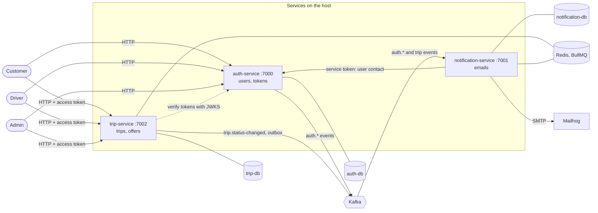

# masr3

**masr3** is the Arabic **مُسْرِع** (_musri'_, "fast, in a hurry"). Use the Arabic spelling
wherever the app is localized into Arabic.

masr3 is an inDrive-style platform that moves people (rides) and things (parcels): a customer
proposes a fare, drivers accept it or counter-offer, and the customer picks one offer.

It is an Nx monorepo of **three NestJS services** (`auth-service`, `notification-service` and
`trip-service`) plus a shared `libs` project. **Docker runs only the infrastructure**: one
Postgres per service behind pgbouncer, Kafka with kafka-ui, Redis with bull-board, pgAdmin and
Mailhog. The services run on the host through Nx. Package manager: **pnpm**.

> This README and `docs/` describe **what exists on `main`**. Planned work is in each service
> doc's **Planned** section. Live location (Socket.IO, Redis GEO, PostGIS) is built but parked on
> branch `wip/live-location`.

## How it fits together



- **Each service owns its database**, reached through pgbouncer. No service reads another's
  tables.
- **Notifications go through one service:** notification-service turns events into email,
  in-app and (later) SMS, WhatsApp and push, and serves the in-app inbox.
- **Synchronous calls are rare:** tokens are verified locally, and the only service-to-service
  HTTP call is notification-service reading a user's contact.
- **State changes travel as Kafka events.** trip-service publishes through a transactional
  outbox, so an event is never lost or invented.

## Services

| Service                                                       | Port | Owns                                        |
| ------------------------------------------------------------- | ---- | ------------------------------------------- |
| [auth-service](docs/services/auth-service.md)                 | 7000 | users, passwords, every token, signing keys |
| [trip-service](docs/services/trip-service.md)                 | 7002 | trips, status history, offers, trip events  |
| [notification-service](docs/services/notification-service.md) | 7001 | templates, delivery, the notifications log  |

Each service doc has its data model, its flows as diagrams, its events and a **Planned** section.

## Guides

| Guide                                                         | Covers                                                 |
| ------------------------------------------------------------- | ------------------------------------------------------ |
| [Infrastructure](docs/infrastructure.md)                      | the Docker stack, ports, pgbouncer, Kafka, Redis, ops  |
| [Adding a service](docs/adding-a-service.md)                  | step by step, with a checklist                         |
| [Authentication](docs/authentication.md)                      | token types, protecting routes, calling services, keys |
| [Transactional outbox](docs/patterns/transactional-outbox.md) | publishing events that must not be lost                |

## Getting started

### Setup

There are no `pnpm` shortcuts — the root `package.json` `scripts` block is **empty**. Use the
commands directly:

```sh
pnpm install
docker compose up -d                                              # infrastructure

cp apps/auth-service/.env.example apps/auth-service/.env          # if missing
cp apps/notification-service/.env.example apps/notification-service/.env
cp apps/trip-service/.env.example apps/trip-service/.env

npx nx run auth-service:generate-signing-key --name=jwt           # RS256 signing key (once)
openssl rand -hex 32                                              # client secret: set it as
# NOTIFICATION_SERVICE_CLIENT_SECRET (auth-service) and SERVICE_CLIENT_SECRET (notification-service)

npx nx run-many -t migrate                                        # schema for every service
npx nx run auth-service:kafka:create-topics                       # Kafka topics (idempotent)
npx nx run trip-service:kafka:create-topics

npx nx run-many -t serve                                          # run all on the host
```

`.env` is gitignored; `.env.example` and `db.env` are committed. Copy the example before first run.

Useful individual targets:

| Command                                                 | What it does                                                                 |
| ------------------------------------------------------- | ---------------------------------------------------------------------------- |
| `npx nx serve auth-service`                             | Run one service on the host                                                  |
| `npx nx run-many -t lint,test,typecheck`                | Lint, test and type-check every project (app, spec and script files)         |
| `npx nx run <service>:migrate`                          | Run pending migrations for one service                                       |
| `npx nx run <service>:migrate-generate --name=X`        | Generate a migration by diffing entities against the live DB                 |
| `npx nx run <service>:migrate-revert`                   | Revert the last migration                                                    |
| `npx nx run auth-service:seed`                          | Seed dev users (`dependsOn: ["migrate"]`)                                    |
| `npx nx run auth-service:kafka:create-topics`           | Create the auth topics, idempotently                                         |
| `npx nx run trip-service:kafka:create-topics`           | Create `trip.status-changed`, idempotently                                   |
| `npx nx run auth-service:generate-signing-key --name=X` | Create `apps/auth-service/secrets/X.{private,public}.pem` (never overwrites) |
| `npx nx run notification-service:preview-templates`     | Render every notification on each channel to `dist/notification-previews/`   |

### Ports

| Service                | App  | Database | Inspector |
| ---------------------- | ---- | -------- | --------- |
| `auth-service`         | 7000 | 41000    | 9229      |
| `notification-service` | 7001 | 41001    | 9230      |
| `trip-service`         | 7002 | 41002    | 9231      |

pgbouncer 41500, Kafka 42000 (kafka-ui 42001), pgAdmin 43000, Redis 44000 (bull-board 44001),
Mailhog SMTP 45000 (web UI 45001). The full map and the naming rules are in
[infrastructure](docs/infrastructure.md#names-and-ports).

### Database scripts (migrate/seed)

Each service defines its own `migrate` / `migrate-generate` / `migrate-revert` /
`migration-show` targets in its `project.json`. They run on the host against pgbouncer's
host-published port (`localhost:41500`), the same address the service uses under `nx serve`;
`POSTGRES_DB` in each `db.env` selects the database. Migrations are always generated by the CLI.

### Running multiple targets at once

```sh
npx nx run-many -t test                                  # `test` on every project
npx nx run-many -t lint,test,typecheck                   # the pre-commit check, every project
npx nx run-many -t test --projects=auth-service,libs     # limit to specific projects
npx nx run-many -t migrate                               # only projects that define migrate
```

### Running tests

Every project, `libs` included, has a `test` target, inferred by `@nx/jest/plugin` (and `lint`
by `@nx/eslint`); `npx nx show project <name>` lists them.

```sh
npx nx test libs                               # one project
npx nx test libs --watch                       # re-run on file changes
npx nx test libs dayjs.spec                    # only spec files matching the pattern
npx nx test libs --coverage                    # coverage report → coverage/libs/
npx nx test libs --skip-nx-cache               # force a real run instead of a cached result
npx nx affected -t test                        # only projects affected by your changes
```

- Pass a filename pattern, not `--testFile`, which plain `jest` silently ignores.
- Specs go next to the code in a `spec/` folder, named `*.spec.ts`. A project with no spec fails
  `nx test` ("No tests found").
- After changing `libs`, test the services that import it too.

### Env files

- `apps/<service>/.env`: real values, gitignored. Copy it from the committed `.env.example`.
  Every variable is required and checked at boot by `config/env/env.validation.ts`.
- `apps/<service>/db.env`: that service's database credentials, committed and dev-only. Both
  the database container and the app read it, so the values exist once.

### Dates — always dayjs, always UTC

**Everything runs in UTC** (`APP_TIMEZONE` in `libs/src/lib/date/timezone.ts`):

- **Columns** are `timestamptz`, so Postgres stores an absolute instant whatever the session zone.
- **Postgres** runs with `timezone=UTC` (the `command:` of each database in `docker-compose.yaml`).
- **Each service** imports `@masr3/libs/timezone` as the first line of `main.ts`. That sets
  `process.env.TZ`, so `dayjs()`, `Date` and Nest's log timestamps are UTC. It has to come first:
  Node fixes a formatter's zone when the formatter is created, and Nest creates its logger's
  formatter on import.
- **dayjs** defaults `dayjs.tz()` to the same zone.

Convert to a user's zone only when formatting something for them to read.

**Use `dayjs` for every date: creating, formatting, comparing, adding or subtracting time.** Do
not use `new Date()`, `Date.now()`, `Date.parse`, `toUTCString()`/`toLocaleString()` or
`Intl.DateTimeFormat`, and do not add another date library.

Import it from the shared lib, never from `dayjs` directly:

```ts
import { dayjs } from '@masr3/libs';

dayjs().toISOString(); // now, for an event or a timestamp
dayjs().add(ttlMs, 'millisecond').toDate(); // an expiry, when TypeORM needs a Date
dayjs(expiresAt).diff(dayjs(from), 'minute'); // a duration
dayjs.utc(iso).format('dddd, D MMMM YYYY [at] HH:mm [UTC]'); // shown to a user
```

`libs/src/lib/date/dayjs.ts` is the one configured instance: it registers the `utc` and `timezone`
plugins once, so every service gets the same behaviour. A plugin a service needs is added there,
not in the service. The one exception is a `Date` that a library requires as a value (a TypeORM
column, a JWT option): produce it with `.toDate()` at that boundary. Test fixtures may still use
literal ISO strings.

### Running the services

The services never run as containers. Run one with `npx nx serve auth-service`, or all with
`npx nx run-many -t serve`. Each `.env` points at host-published ports (pgbouncer
`localhost:41500`, Kafka `localhost:42000`), so it works whether one service runs or all.

Every `nx serve` also opens a Node inspector on the service's own port (9229–9231). Keep it
running and start an **Attach …** configuration from `.vscode/launch.json`, or **Attach all
services**; they reattach after each rebuild.

### Trying the trip flow

Seeded users, password `ChangeMe123!` (login is rate-limited to 3/s):

```sh
A=http://localhost:7000/api; T=http://localhost:7002/api
tok() { curl -s -X POST $A/auth/login -H 'Content-Type: application/json' \
  -d "{\"email\":\"$1\",\"password\":\"ChangeMe123!\"}" | jq -r .accessToken; }
C=$(tok customer@masr3.local); sleep 1; D=$(tok rider@masr3.local)

TRIP=$(curl -s -X POST $T/trips -H "Authorization: Bearer $C" -H 'Content-Type: application/json' \
  -d '{"type":"RIDE","pickupLatitude":30.0444,"pickupLongitude":31.2357,"pickupAddress":"Tahrir",
       "dropoffLatitude":30.0131,"dropoffLongitude":31.2089,"dropoffAddress":"Giza","proposedFare":85}' | jq .id)
OFFER=$(curl -s -X POST $T/trips/$TRIP/offers -H "Authorization: Bearer $D" \
  -H 'Content-Type: application/json' -d '{"amount":90}' | jq .id)
curl -s -X POST $T/trips/$TRIP/offers/$OFFER/accept -H "Authorization: Bearer $C" | jq .status
for step in arrived start complete; do
  curl -s -X POST $T/trips/$TRIP/$step -H "Authorization: Bearer $D" | jq .status
done
curl -s $T/trips/$TRIP/history -H "Authorization: Bearer $C" | jq '.[].toStatus'
```

Accepting and completing the trip send emails (cancelling and expiring do too); read them in
Mailhog at `http://localhost:45001`.
To look at every email without sending one:
`npx nx run notification-service:preview-templates` (→ `dist/notification-previews/index.html`).

### API docs (Swagger)

| Service                | UI                               | OpenAPI JSON        |
| ---------------------- | -------------------------------- | ------------------- |
| `auth-service`         | `http://localhost:7000/api/docs` | `.../api/docs-json` |
| `notification-service` | `http://localhost:7001/api/docs` | `.../api/docs-json` |
| `trip-service`         | `http://localhost:7002/api/docs` | `.../api/docs-json` |

auth-service's Swagger groups the service-only routes (`/service-tokens`, `/internal/...`) under the
`internal` tag; use **Authorize** with `bearer` for user and service tokens, `basic` for client
credentials.

### UIs

| UI         | URL                      | Shows                                                     |
| ---------- | ------------------------ | --------------------------------------------------------- |
| pgAdmin    | `http://localhost:43000` | every database, pre-registered                            |
| kafka-ui   | `http://localhost:42001` | topics, messages, consumer groups                         |
| bull-board | `http://localhost:44001` | BullMQ queues: scheduled, delayed, completed, failed jobs |
| Mailhog    | `http://localhost:45001` | every email sent in development                           |
