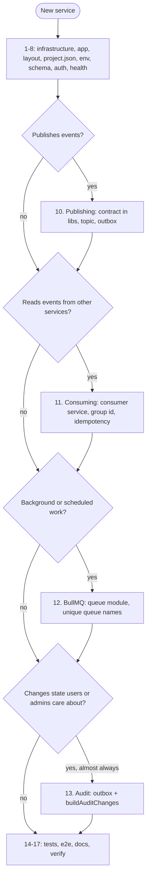
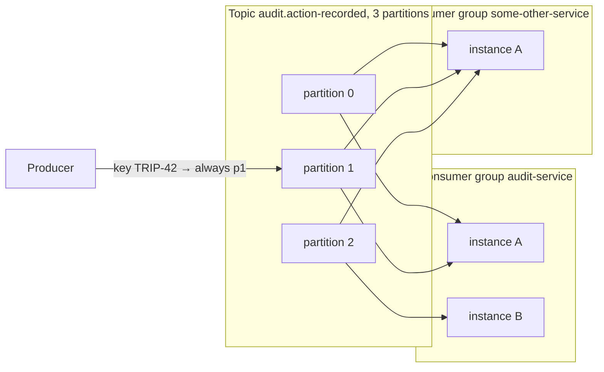

# Adding a service

How to add a NestJS service to masr3, from Docker to docs, including Kafka producers and
consumers, BullMQ, the outbox and the audit trail. The examples call the new service
`rating-service`; replace the name, ports and database throughout.

Copy from the service closest to what you are building:

| You are building                            | Copy from                                                       |
| ------------------------------------------- | --------------------------------------------------------------- |
| Any service (layout, env, auth, migrations) | `apps/trip-service`: the leanest service with every pattern     |
| A **producer** of events that must not drop | `OutboxModule` from `@masr3/libs` (transactional outbox)        |
| A **consumer** of Kafka events              | `apps/audit-service/src/kafka/` (one topic, generic handler)    |
| A consumer of many topics, with handlers    | `apps/notification-service/src/kafka/`                          |
| Background jobs                             | `apps/trip-service/src/queue/` and `modules/trip/trip-expiry.*` |

## 0. Decide the service's role

Answer these first. Each "yes" adds a section below; each "no" lets you skip one.



Read the [Kafka primer](#9-kafka-primer) before steps 10 and 11 if topics, partitions and consumer
groups are new to you.

## 1. Pick the next free numbers

| What             | Rule                 | Taken                                                                                                    | Next       |
| ---------------- | -------------------- | -------------------------------------------------------------------------------------------------------- | ---------- |
| App port         | 7000 + n             | auth 7000, notification 7001, trip 7002, audit 7003, vehicle 7004                                        | **7005**   |
| Database port    | 41000 + n            | auth-db 41000 … vehicle-db 41004                                                                         | **41005**  |
| Inspector port   | 9229 + n             | 9229 … 9233                                                                                              | **9234**   |
| BullMQ queue     | globally unique name | `trip-outbox-relay` (trip), `auth-outbox-relay`, `vehicle-outbox-relay`, `trip-expiry`, `notification-*` | `rating-…` |
| Advisory lock id | `<port>` + 3 digits  | 7000001 (auth relay), 7002001 (trip relay), 7004001 (vehicle relay)                                      | `7005001`  |

## 2. Infrastructure

- **`docker-compose.yaml`**: copy the `audit-db` block as `rating-db`: image
  `postgres:16-alpine`, `container_name: masr3-rating-db`, port `41004:5432`,
  `env_file: ./apps/rating-service/db.env`, the same UTC `environment` / `command`, the
  `pg_isready` healthcheck, a `masr3_rating_db_data` volume (and its entry under `volumes:`).
- **Add `rating-db` to both `depends_on` lists**, `pgbouncer` and `pgadmin`. This is easy to
  miss; without it pgbouncer can start before the database exists.
- **`infrastructure/pgbouncer/pgbouncer.ini`**:
  `rating_db = host=masr3-rating-db port=5432 dbname=rating_db`; the user and password in
  `userlist.txt`.
- **`infrastructure/ui/servers.json`**: a server entry for pgAdmin.
- Start it, **always with `--no-deps`** (without it Compose may recreate other databases with
  fresh, empty volumes):

  ```sh
  docker compose up -d --no-deps rating-db
  docker compose restart pgbouncer
  docker exec masr3-pgadmin /venv/bin/python3 /pgadmin4/setup.py load-servers \
    /pgadmin4/servers.json --user pgadmin4@pgadmin.org --replace
  ```

## 3. Generate the app

```sh
npx nx g @nx/nest:app apps/rating-service --linter=eslint --unitTestRunner=jest --e2eTestRunner=jest --no-interactive
```

The generator also updates `nx.json` (the jest exclude for the e2e project) and
`.vscode/launch.json`. Delete `src/app/`.

## 4. Service layout

```text
apps/rating-service/
  .env  .env.example  db.env  project.json  webpack.config.js
  scripts/kafka-create-topics.sh     only if the service owns topics
  src/
    main.ts             first line: import '@masr3/libs/timezone';
    app.module.ts
    config/             config.module.ts + env/env.validation.ts + env/spec/
    database/           database.module.ts, data-source.ts, migrations/
    health/             public GET /api/health
    kafka/              producer and/or consumer service + module + spec/;
                        kafka.interface.ts: OutboxEventMap (the outbox itself is in libs)
    queue/              BullMQ root module (only with jobs or an outbox)
    shared/             service-scoped helpers (transformers)
    modules/audit/      AuditRecorderService (produces audit events; needs the outbox)
    modules/<name>/     entities/, dto/, <name>.enum|constant|interface.ts,
                        module, service, controller, spec/ (dto specs in spec/dto/)
```

- **Code style** is in `CLAUDE.md`. Two rules new code most often breaks: never destructure an
  object in a parameter (`list(query)` then `query.page`), and build a list's filters in a
  private `prepareListWhere(query)`, never inline in the list method.
- **`main.ts`**: copy from trip-service: the `/api` prefix, the global `ValidationPipe`
  (`whitelist`, `transform`), the `ClassSerializerInterceptor` with
  `excludeExtraneousValues: true`, Swagger at `/api/docs`, the port from env.
- **`config.module.ts`**: `envFilePath: ['apps/rating-service/.env', 'apps/rating-service/db.env']`.
- **Shared code** already in `@masr3/libs`: pagination (`PaginationQueryDto`, `paginate`,
  `paginationWindow`, `PaginatedResponseDto(Item)`), `isUniqueViolation`, money
  (`MONEY_COLUMN_OPTIONS`, `@IsMoney()`, `decimalTransformer`)
  and the outbox. A list query DTO `extends PaginationQueryDto`; a paginated response is
  `class PaginatedRatingsResponseDto extends PaginatedResponseDto(RatingResponseDto) {}`.
  Anything else stays in the service's `shared/` until a second service needs it.

## 5. `project.json`

- **Migrations:** copy `migrate`, `migrate-generate`, `migrate-revert`, `migration-show` from
  trip-service with the paths changed. Keep `TS_NODE_BASEURL="$PWD" NODE_OPTIONS="-r tsconfig-paths/register"`:
  as soon as an entity imports `@masr3/libs`, the CLI fails without it.
- **`typecheck`**: copy it. Give the e2e project its own `typecheck` too.
- **Inspector port:** set `serve.options.port` to **9233**. Every `nx serve` opens an inspector;
  without its own port the second service fails with "address already in use". Never put
  `--inspect` in `NODE_OPTIONS`: every child process (npx, nx, webpack) would grab the port.
- **Attach config:** add **Attach rating-service (9233)** to `.vscode/launch.json` and to the
  "Attach all services" compound.
- **Topics** (only if the service owns topics): a `kafka:create-topics` target that runs
  `scripts/kafka-create-topics.sh`, copied from audit-service:

  ```json
  "kafka:create-topics": {
    "executor": "nx:run-commands",
    "options": { "command": "bash scripts/kafka-create-topics.sh", "cwd": "{projectRoot}" }
  }
  ```

## 6. Environment

Every variable is **required** and validated at boot by `config/env/env.validation.ts`. Add a
variable only when code reads it, and change **all four** places in one change:
`env.validation.ts`, `.env.example`, `.env`, and the env spec (`validEnv` and its lists).

| Family          | Variables                                                                                                           | Needed when                        |
| --------------- | ------------------------------------------------------------------------------------------------------------------- | ---------------------------------- |
| Base            | `NODE_ENV`, `PORT=7004`, `SERVICE_NAME=rating-service`                                                              | always                             |
| Database        | `DATABASE_HOST=localhost`, `DATABASE_PORT=41500` + `db.env`                                                         | always                             |
| `db.env`        | `POSTGRES_USER`, `POSTGRES_PASSWORD`, `POSTGRES_DB=rating_db` (committed)                                           | always                             |
| Auth            | `AUTH_SERVICE_URL=http://localhost:7000/api` (JWKS)                                                                 | always (the guard verifies tokens) |
| Kafka (any)     | `KAFKA_BROKER=localhost:42000`, `KAFKA_CLIENT_ID=rating-service`                                                    | produces or consumes               |
| Kafka consumer  | `KAFKA_CONSUMER_GROUP_ID=rating-service`                                                                            | consumes                           |
| Redis / BullMQ  | `REDIS_HOST=localhost`, `REDIS_PORT=44000`                                                                          | jobs or an outbox                  |
| Outbox          | `OUTBOX_POLL_INTERVAL_MS`, `OUTBOX_BATCH_SIZE`, `OUTBOX_RETENTION_MS`, `OUTBOX_RELAY_QUEUE`, `OUTBOX_RELAY_LOCK_ID` | has an outbox                      |
| Calls a service | `SERVICE_CLIENT_ID` / `SERVICE_CLIENT_SECRET` (see authentication guide)                                            | calls another service's API        |

- Copy `.env.example` from a service with the same families and **change the values**: a copied
  `PORT=7000` or `SERVICE_NAME=trip-service` boots on the wrong port or under the wrong name.
- **The env spec lists only variables the service has.** Copying trip-service's spec brings
  `REDIS_PORT` into a service without Redis: `whitelist` strips the unknown key, nothing throws,
  and the "rejects REDIS_PORT=0" test fails.
- Booleans go through the service's `toBoolean` transformer: implicit conversion reads `'false'`
  as `true`.

## 7. Schema and migrations

Write the entities, list them in **both** `database.module.ts` and `data-source.ts`, then let the
CLI write the migration. Never write one by hand.

```sh
npx nx run rating-service:migrate-generate --name=create-ratings
npx prettier --write apps/rating-service/src/database/migrations/*-create-ratings.ts
npx nx run rating-service:migrate
npx nx run rating-service:migrate-revert && npx nx run rating-service:migrate
npx nx run rating-service:migrate-generate --name=check   # must report "No changes"
```

- Tables are plural snake_case (`ratings`), ids `serial`, dates `timestamptz`, enums real
  Postgres enums (unless, like audit-service, the values come from other services), money
  `decimal` with `decimalTransformer`.
- An uncommitted migration may be reverted, deleted and regenerated. A committed one never is:
  add a new migration.
- TypeORM never drops a table it doesn't know about. Renaming an entity's table creates the new
  table and leaves the old one; dropping the old one needs a decision, so ask.

## 8. Auth and health

Register `AuthenticationModule.register()` and `{ provide: APP_GUARD, useExisting: AuthenticationGuard }`
from `@masr3/libs` (after the throttler, if any). The guard is **closed by default**:

- `@Roles(UserRoleEnum.ADMIN)` (class or route) for user routes, `@CurrentUser()` for the
  caller. Admin-only controllers live under `admin/...` (e.g. `admin/audits`).
- `GET /api/health` is `@Public()` and returns `{ status, service: SERVICE_NAME, timestamp }`.
- Service-only routes go under `/internal/...` with `@RequireServiceScopes(...)`.

Details: [authentication](authentication.md).

## 9. Kafka primer

What you need to know before producing or consuming:



- **Topic:** a named, append-only log of messages (`trip.status-changed`). Messages stay for the
  topic's retention whether or not anyone read them.
- **Partition:** a topic is split into partitions (3 here). **Order is guaranteed only within a
  partition**, never across partitions or topics.
- **Key:** the producer gives each message a key; the same key always goes to the same
  partition. Key by the aggregate (`tripId`, `USER-7`), so one entity's events stay in order.
  That's also why every status change of a trip goes on **one** topic: per-status topics could
  deliver "cancelled" before "accepted".
- **Consumer group (`KAFKA_CONSUMER_GROUP_ID`):** the identity of a reader.
  - **Every message is delivered once per group.** Inside a group, the partitions are split
    between the running instances. Run 2 instances of audit-service with the same group id and
    each stores about half the events, never the same one twice.
  - **Different groups are independent.** notification-service and audit-service each have their
    own group, so each receives every message of the topics it subscribes to.
  - **Use the service name as the group id**, one group per service. Never share a group id
    between two services: they would split the messages and each would miss half.
  - **The group remembers where it is** (its committed offset per partition). Restart the
    service and it continues where it stopped, including messages produced while it was down.
  - **Renaming the group** starts a new reader with no offsets: it begins at
    `fromBeginning` (oldest retained message) or at the latest message, see step 11.
  - See groups and their lag in kafka-ui (`http://localhost:42001`, Consumers).
- **Offset commit:** kafkajs commits a message's offset after your `eachMessage` handler returns.
  If the handler throws, the offset is not committed and the message is delivered again.
- **At-least-once:** a message can arrive twice (a retry, a relay resending a batch, a
  rebalance). **Every consumer must be idempotent**: store the event's `eventId` in a unique
  column and treat Postgres `23505` as "already handled".
- **Topics must exist.** Auto-creation is off on the broker and on every client
  (`allowAutoTopicCreation: false`). A producer to a missing topic fails; a consumer subscribing
  to one fails at boot. The **owner** of a topic creates it with `kafka:create-topics`.

## 10. Publishing events

1. **Contract** in `libs/src/lib/kafka/<domain>/`:
   - `<domain>.topics.ts`: `enum RatingKafkaTopic { SUBMITTED = 'rating.submitted' }`.
   - `<domain>.events.ts`: payload interfaces extending `BaseKafkaEvent`, and a
     `RatingEventMap { [RatingKafkaTopic.SUBMITTED]: RatingSubmittedEvent }`, exported with
     `export type`.
   - Export both from `libs/src/lib/kafka/index.ts` (imported as `@masr3/libs/kafka`).
2. **Never set `eventId` / `occurredAt`.** Pass an `EventPayload<T>`; `createKafkaEvent` fills
   both, inside `publish` or the outbox's `enqueue`.
3. **Create the topic:** `scripts/kafka-create-topics.sh` (copy audit-service's) with a `TOPICS`
   list that matches the enum, plus the `kafka:create-topics` target from step 5. Run it.
4. **Choose how to publish:**
   - **Outbox** (default): the event must not be lost or invented, because other services act
     on it. Register `OutboxModule.forRoot({ imports: [KafkaModule], producer: KafkaProducerService })`
     in `AppModule` (copy `kafka/kafka-producer.service.ts` and `queue/queue.module.ts`), declare
     `OutboxEventMap` in `kafka/kafka.interface.ts`, inject
     `OutboxService<OutboxEventMap>`, and call `enqueue(manager, topic, payload, key)` with the
     **transaction's** `manager`. Set the service's own `OUTBOX_RELAY_QUEUE` and
     `OUTBOX_RELAY_LOCK_ID` in env (step 1). Full guide:
     [transactional outbox](patterns/transactional-outbox.md).
   - **Direct, best-effort:** only when losing the event is harmless (auth-service's sign-in
     alert). `publish()` logs and swallows broker errors.

## 11. Consuming events

Copy `apps/audit-service/src/kafka/` (one topic) or `apps/notification-service/src/kafka/`
(many topics with different handlers).

1. **Env:** `KAFKA_BROKER`, `KAFKA_CLIENT_ID`, `KAFKA_CONSUMER_GROUP_ID=rating-service` in all
   four places (step 6).
2. **The consumer service** (`kafka/kafka-consumer.service.ts`):

   ```ts
   type ConsumedEventMap = TripEventMap; // & AuthEventMap & …

   type TopicHandlers = {
     [Topic in keyof ConsumedEventMap]: (event: ConsumedEventMap[Topic]) => Promise<unknown>;
   };

   // in the constructor
   this.consumer = kafka.consumer({
     groupId: configService.getOrThrow<string>('KAFKA_CONSUMER_GROUP_ID'),
     allowAutoTopicCreation: false,
   });
   this.handlers = {
     [TripKafkaTopic.STATUS_CHANGED]: (event) => this.ratingService.handleTripStatus(event),
   };
   ```

   The handler map is typed against the event map: a topic you subscribe to without a handler
   is a compile error, not a silently ignored message.

3. **Subscribe and run** in `onModuleInit`; disconnect in `onModuleDestroy`:

   ```ts
   await this.consumer.connect();
   await this.consumer.subscribe({ topics: [TripKafkaTopic.STATUS_CHANGED], fromBeginning: false });
   await this.consumer.run({ eachMessage: (payload) => this.handleMessage(payload) });
   ```

   **`fromBeginning`** only matters while the group has no committed offset (first run, or a
   renamed group):
   - `true`: read everything still on the topic. Right for a record of history (audit-service)
     or for events that must all be handled (welcome emails for users who signed up before the
     service existed).
   - `false`: start at the latest message. Right when old events would cause harm, such as
     emailing every past trip.

4. **`handleMessage`: skip what can never succeed, rethrow everything else.**
   - Unknown topic, empty value, bad JSON, missing required fields: **log and return**. The
     offset is committed, so one poison message can't block the partition forever.
   - Anything else (database down, a bug): **let it throw**. The offset is not committed and
     kafkajs redelivers, so the event is not lost.
   - Validate the parsed JSON with a class-validator DTO that `implements` the libs event
     interface (`plainToInstance` + `validateSync`, as audit-service's
     `AuditActionRecordedEventDto`). Check everything the insert depends on: formats
     (`@IsISO8601`), ranges (`@Max(POSTGRES_INT_MAX)` for an `int` column), nested objects
     (`@ValidateNested` + `@Type`). Log the failing fields. Prefer `@IsString` over `@IsEnum` for
     values other services may extend, or a new value will be skipped.
5. **Make the handler idempotent:** a unique column on `eventId` (`@Index(UQ_X_EVENT_ID, ['eventId'], { unique: true })`),
   insert first, and on `isUniqueViolation(error, UQ_X_EVENT_ID)` return as already handled.
6. **`kafka/kafka.module.ts`** imports `ConfigModule` and the feature modules that hold the
   handlers, provides `KafkaConsumerService`, and is imported by `app.module.ts`. It imports only
   files that exist: a consumer-only service has no `kafka-producer.service.ts`.
7. **Make sure the topic exists** before you boot: run its owner's `kafka:create-topics`.
8. **Spec it** (`kafka/spec/kafka-consumer.service.spec.ts`, copy audit-service's): dispatch to
   the handler, skip each kind of malformed message, ignore an unknown topic, rethrow a handler
   failure.

## 12. Background jobs (BullMQ)

- Copy `queue/queue.module.ts` (the Redis connection) and import it in `app.module.ts`. Env:
  `REDIS_HOST`, `REDIS_PORT`.
- Register each queue in its feature module with `BullModule.registerQueue({ name })`.
- **Queue names and scheduler ids are global.** Every service uses the same Redis with BullMQ's
  default prefix. Two services with the same queue name share one queue, and whichever
  worker is free takes the other service's jobs. Prefix with the service, in lowercase kebab-case (`rating-…`).
- Repeating work: `queue.upsertJobScheduler(SCHEDULER_ID, { every: ms }, { name: JobEnum.X })`
  on boot. Work at a future moment: a delayed job with a stable `jobId`, queued after the
  transaction commits, backed by a sweep. Never `setTimeout` / `setInterval`.
- Processors extend `WorkerHost`, switch on `job.name`, return when there's nothing to do,
  throw on unexpected errors, and are safe to run twice.
- After a new queue appears: `docker compose up -d --no-deps --force-recreate bull-board`.

## 13. Joining the audit trail

Every state change a user or admin may later ask "who did this?" about is audited. The design is
in [audit-service](services/audit-service.md); a producer needs:

1. **An outbox** (step 10). Audit events must not be lost, so they never go direct.
2. **Libs values:** add your entity to `AuditEntityTypeEnum` and your actions to
   `AuditActionEnum` (`libs/src/lib/kafka/audit/audit.enum.ts`). audit-service needs no change.
3. **Type the outbox** over `AuditEventMap` too (`type OutboxEventMap = RatingEventMap & AuditEventMap`).
4. **An allow-list** in `<module>.constant.ts`: `RATING_AUDITED_FIELDS`, the columns a diff may
   contain. **Never list a password, hash, token or other secret.**
5. **`modules/audit/`**, copied unchanged from trip-service or auth-service: `audit.module.ts`,
   `audit-recorder.service.ts`, `audit.interface.ts` (`AuditRecord`)
   and its spec. `AuditRecorderService.record(manager, record)` adds
   `schemaVersion: AUDIT_EVENT_SCHEMA_VERSION`, `service` from `SERVICE_NAME` and the
   `buildAuditEventKey(entity)` key, then enqueues into the outbox. One per service, shared by
   all its features: never write a per-feature audit helper. Feature modules import
   `AuditModule`.
6. **In each write**, inside the transaction: lock the row (the `before`), write, re-read (the
   `after`), then call `auditRecorder.record(manager, { action, entity, actor, changes, metadata })`
   with `changes: buildAuditChanges(before, after, RATING_AUDITED_FIELDS)` (`before` null for a
   creation, `after` null for a deletion). The feature owns the allow-list and the diff; the
   recorder owns the envelope.
7. **Actor:** `buildUserAuditActor(currentUser)` for a signed-in user, `SYSTEM_AUDIT_ACTOR` for a
   job, `ANONYMOUS_AUDIT_ACTOR` for an unauthenticated request.
8. Produce to `audit.action-recorded`; audit-service owns and creates it.

## 14. Tests

- Specs sit next to the code in `spec/`, named `*.spec.ts`. Every project needs at least one real
  spec, or `nx test` fails with "No tests found"; the env spec is the minimum.
- Mock repositories as `jest.Mocked<Repository<X>>`, fixtures as typed objects. For a
  transaction, mock `dataSource.transaction` to call the callback with a mocked `EntityManager`.
- Run one spec with a pattern: `npx nx test rating-service consumer` (not `--testFile`).
- A response DTO serialises through `excludeExtraneousValues: true`: every field needs
  `@Expose()`, and a route without `@SerializeOptions({ type })` returns `{}` for a bare entity.

## 15. E2E

Replace the generated spec (it expects `GET /api` → `Hello API`) with trip-service's: `GET /api/health`
returns `{ status: 'ok', service: 'rating-service' }`. Point `global-setup.ts`,
`global-teardown.ts` and `test-setup.ts` at port 7004.

## 16. Docs

- `docs/services/rating-service.md`: what it owns, a context `flowchart`, an `erDiagram`, one
  `sequenceDiagram` per important flow, `stateDiagram-v2` for status columns, its events, and a
  **Planned** section. Copy the shape of [trip-service](services/trip-service.md) or
  [audit-service](services/audit-service.md).
- `README.md`: the services table and diagram, the ports table, the setup `cp` line, any
  `kafka:create-topics` line, the Swagger table.
- `CLAUDE.md`: the services table (and the Redis sentence if it uses Redis).
- `docs/infrastructure.md`: the stack diagram, the ports, the Kafka diagram, the queues.
- If it produces to or consumes another service's topic, update that service's doc too.

## 17. Verify

- [ ] `npx nx run-many -t lint,test,typecheck` passes.
- [ ] `migrate`, `migrate-revert`, `migrate` succeed; a second `migrate-generate` reports "No
      changes".
- [ ] `npx nx run rating-service:kafka:create-topics` (if it owns topics), then the topic shows in
      kafka-ui.
- [ ] `npx nx serve rating-service`, then `curl localhost:7004/api/health`.
- [ ] A consumer logs "Successfully subscribed to N Kafka topic(s)", and its group shows in
      kafka-ui with lag 0 after a test event.
- [ ] The same event delivered twice is stored once.
- [ ] Removing one key from `.env` makes boot fail.
- [ ] `npx nx e2e rating-service-e2e` passes.
- [ ] The debugger attaches on 9233 while the other services run.
- [ ] New queues show in bull-board after recreating it.

## Troubleshooting

| Symptom                                                            | Cause and fix                                                                                                                                                                                                                                     |
| ------------------------------------------------------------------ | ------------------------------------------------------------------------------------------------------------------------------------------------------------------------------------------------------------------------------------------------- |
| Build fails: `Can't resolve './kafka-producer.service'`            | `kafka.module.ts` was copied from a producer. A consumer-only service provides `KafkaConsumerService` and imports the modules its handlers use.                                                                                                   |
| `Cannot find module '@masr3/libs'` when migrating                  | The `migrate*` targets lack `TS_NODE_BASEURL="$PWD" NODE_OPTIONS="-r tsconfig-paths/register"`.                                                                                                                                                   |
| `address already in use :::9229` on serve                          | The serve target has no `port`. Give it the next inspector port.                                                                                                                                                                                  |
| Service boots on another service's port                            | `.env.example` / `.env` copied without changing `PORT` / `SERVICE_NAME`.                                                                                                                                                                          |
| "running in another Nx process"                                    | A previous `nx serve` still runs. Kill its whole tree, `nx.js` included (`ps -eo pid,args \| grep "[n]x serve"`).                                                                                                                                 |
| Env spec test "rejects REDIS_PORT=0" fails                         | The spec was copied from a service with Redis. List only this service's variables.                                                                                                                                                                |
| `This server does not host this topic-partition` / subscribe fails | The topic doesn't exist. Run its owner's `kafka:create-topics`.                                                                                                                                                                                   |
| Consumer receives nothing                                          | Wrong broker, the topic is empty, `fromBeginning: false` on a new group, or another service uses the same group id and takes the partitions.                                                                                                      |
| Consumer replays the whole topic                                   | `KAFKA_CONSUMER_GROUP_ID` changed: a new group has no offsets. Harmless if the handler is idempotent.                                                                                                                                             |
| The same message is retried forever                                | The handler throws for a message that can never succeed. Validate it with a DTO in `parse` and skip it instead.                                                                                                                                   |
| Duplicate rows from one event                                      | No unique `eventId` column, or the `23505` isn't caught by constraint name.                                                                                                                                                                       |
| Jobs of one service run in another                                 | Two services use the same BullMQ queue name. Prefix it with the service.                                                                                                                                                                          |
| A route returns `{}`                                               | No `@SerializeOptions({ type })`, or a response DTO field without `@Expose()`.                                                                                                                                                                    |
| `CREATE TYPE … already exists` in a generated migration            | Two columns share an `enumName`. Keep TypeORM's default enum names.                                                                                                                                                                               |
| pgbouncer can't reach the new database after `docker compose up`   | `rating-db` is missing from `pgbouncer.depends_on`, or pgbouncer wasn't restarted after editing `pgbouncer.ini`.                                                                                                                                  |
| `password authentication failed` on boot                           | The user is missing from `userlist.txt` (or its password differs from `db.env`), or pgbouncer wasn't restarted after editing it. If `db.env` changed after the database first started, reset its volume ([infrastructure.md](infrastructure.md)). |
| `cp` or `rm` hangs in a script                                     | They are aliased to interactive mode in this shell. Use `cp -f` / `rm -f` (`command cp -f` if `-f` still prompts).                                                                                                                                |
