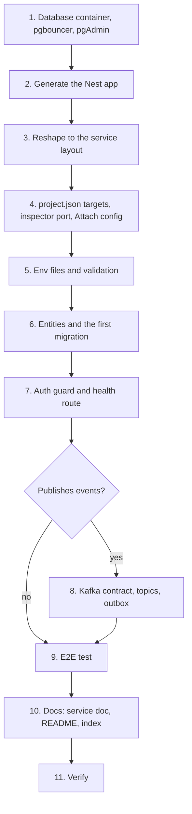

# Adding a service

How to add a NestJS service to masr3, from Docker to docs. `apps/trip-service` is the reference:
it is the leanest service that has every pattern, so copy from it. The examples call the new
service `rating-service`; replace the name, ports and database throughout.



## 1. Infrastructure

Pick the next free numbers: database host port **41003**, app port **7003**, inspector **9232**.

- **`docker-compose.yaml`**: copy the `trip-db` block as `rating-db`: image
  `postgres:16-alpine`, `container_name: masr3-rating-db`, port `41003:5432`,
  `env_file: ./apps/rating-service/db.env`, the same UTC `command` and `pg_isready`
  healthcheck, a `masr3_rating_db_data` volume. Add it to `pgbouncer.depends_on` and
  `pgadmin.depends_on`.
- **`infrastructure/pgbouncer/pgbouncer.ini`**: `rating_db = host=masr3-rating-db port=5432 dbname=rating_db`,
  and its user and password in `userlist.txt`.
- **`infrastructure/ui/servers.json`**: a server entry for pgAdmin.
- Start it: `docker compose up -d --no-deps rating-db`, then `docker compose restart pgbouncer`.
  Re-import pgAdmin's servers (see [infrastructure](infrastructure.md#pgadmin)).

## 2. Generate the app

```sh
npx nx g @nx/nest:app apps/rating-service --linter=eslint --unitTestRunner=jest --e2eTestRunner=jest --no-interactive
```

The generator also updates `nx.json` (the jest exclude for the e2e project) and
`.vscode/launch.json`. Delete `src/app/`.

## 3. Service layout

```text
apps/rating-service/
  .env  .env.example  db.env  project.json  webpack.config.js
  src/
    main.ts             first line: import '@masr3/libs/timezone';
    app.module.ts
    config/             ConfigModule + env/env.validation.ts (+ spec)
    database/           database.module.ts, data-source.ts, migrations/
    health/             public GET /api/health
    modules/<name>/     entities/, dto/, <name>.enum|constant|interface.ts, module, service, controller, spec/
```

Copy `main.ts` from trip-service: the `/api` prefix, the global `ValidationPipe`, the
`ClassSerializerInterceptor` with `excludeExtraneousValues`, Swagger at `/api/docs`, the port
from env.

## 4. `project.json`

- Copy `migrate`, `migrate-generate`, `migrate-revert`, `migration-show` and `typecheck` from
  trip-service, with paths changed. If entities import `@masr3/libs`, keep the
  `TS_NODE_BASEURL` / `tsconfig-paths` settings, or the CLI cannot find the lib.
- Set the serve target's `port` to **9232**: every `nx serve` opens an inspector, and two on one
  port fail with "address already in use". Never put `--inspect` in `NODE_OPTIONS`.
- Add an **Attach rating-service (9232)** configuration to `.vscode/launch.json`, and add it to
  the "Attach all services" compound.
- Give the e2e project a `typecheck` target too.

## 5. Environment

- `db.env`: `POSTGRES_USER`, `POSTGRES_PASSWORD`, `POSTGRES_DB=rating_db`, committed.
- `.env.example` and `.env`: `NODE_ENV`, `PORT=7003`, `SERVICE_NAME=rating-service`,
  `DATABASE_HOST=localhost`, `DATABASE_PORT=41500`, and `AUTH_SERVICE_URL` (for the JWKS) copied
  from trip-service.
- `env.validation.ts` checks every variable; the spec lists them all. Every variable is
  required; add one only when code uses it, and update all four files in the same change.

## 6. Schema

Write the entities (plural snake_case tables, `timestamptz` dates, real Postgres enums), list
them in both `database.module.ts` and `data-source.ts`, then let the CLI write the migration:

```sh
npx nx run rating-service:migrate-generate --name=create-rating-tables
npx prettier --write apps/rating-service/src/database/migrations/*
npx nx run rating-service:migrate
npx nx run rating-service:migrate-revert && npx nx run rating-service:migrate
npx nx run rating-service:migrate-generate --name=check   # must report "No changes"
```

Never write a migration by hand.

## 7. Auth and health

Register `AuthenticationModule.register()` and `{ provide: APP_GUARD, useExisting: AuthenticationGuard }`
from `@masr3/libs`, after the throttler. The guard is closed by default: protect routes with
`@Roles(...)`, keep `GET /api/health` `@Public()`. To call another service, add a client to
`SERVICE_CLIENTS` in auth-service and use `ServiceTokenProvider`. See
[authentication](authentication.md).

## 8. If the service publishes events

- Contract in `libs/src/lib/kafka/<domain>/`: a topic enum and an event map, exported from
  `libs/src/index.ts`.
- A `kafka:create-topics` target whose list matches the enum.
- Events other services rely on go through a transactional outbox: follow
  [the outbox pattern](patterns/transactional-outbox.md), copying trip-service's
  `modules/outbox/`. That also brings BullMQ (Redis) for the relay job.

## 9. E2E

Point the generated e2e spec at `GET http://localhost:7003/api/health`.

## 10. Docs

- `docs/services/rating-service.md`: what it owns, a context diagram, its data model, its flows
  as sequence diagrams, state machines, events, and a Planned section. Copy the shape of
  [trip-service's doc](services/trip-service.md).
- Link it from the services table in the root [README](../README.md), add it to the services table in `CLAUDE.md`, and
  update README's service list, setup `cp` line and Swagger table.
- Add the new ports to [infrastructure](infrastructure.md#names-and-ports).

## 11. Verify

- [ ] `npx nx run-many -t lint,test,typecheck` passes.
- [ ] `migrate`, `migrate-revert`, `migrate` succeed; a second `migrate-generate` reports "No
      changes".
- [ ] `npx nx serve rating-service`, then `curl localhost:7003/api/health`.
- [ ] Removing one key from `.env` makes boot fail.
- [ ] `npx nx e2e rating-service-e2e` passes.
- [ ] The debugger attaches on 9232 while the other services run.
