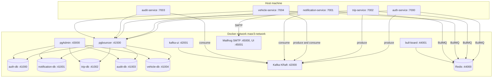
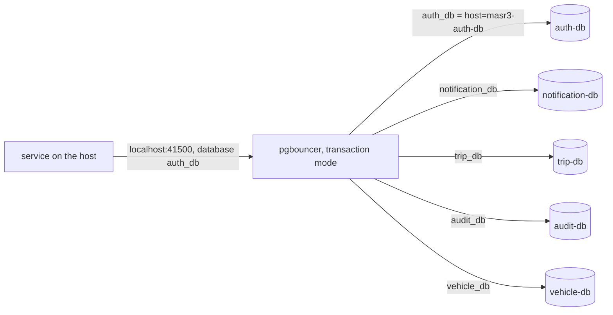
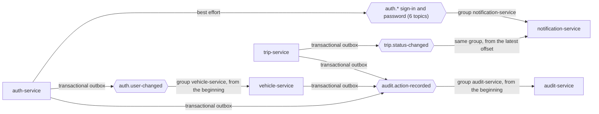

# Infrastructure

Docker runs **only the infrastructure**. The apps run on the host through Nx (`npx nx serve <svc>`),
so they get webpack watch and the debugger with no image rebuilds. Everything is defined in
`docker-compose.yaml`, on one bridge network named `masr3-network`.

## The stack



Apps reach every container through its **host-published** port (`localhost:41500`,
`localhost:42000`, …), never a Docker hostname, so one `.env` works whether one service runs or
all of them.

## Names and ports

Compose keys are plain names (`docker compose logs auth-db`); each `container_name` is prefixed
`masr3-` (`masr3-auth-db`). Host ports are grouped in bands; container ports keep each image's
default.

| Band  | Category       | Assigned                                                                                        |
| ----- | -------------- | ----------------------------------------------------------------------------------------------- |
| 41000 | Databases      | `auth-db`=41000, `notification-db`=41001, `trip-db`=41002, `audit-db`=41003, `vehicle-db`=41004 |
| 41500 | pgbouncer      | `pgbouncer`=41500                                                                               |
| 42000 | Messaging      | `kafka` (host listener)=42000, `kafka-ui`=42001                                                 |
| 43000 | DB / infra UI  | `pgadmin`=43000                                                                                 |
| 44000 | Queues         | `redis`=44000, `bull-board`=44001                                                               |
| 45000 | Dev-only tools | `mailhog` SMTP=45000, web UI=45001                                                              |

- A UI sits next to the thing it shows: kafka 42000 → kafka-ui 42001, redis 44000 → bull-board 44001.
- Databases are numbered in the order they were added; the next service takes 41005.
- Apps: auth-service 7000, notification-service 7001, trip-service 7002, audit-service 7003,
  vehicle-service 7004. Node inspectors: 9229, 9230, 9231, 9232, 9233 (each serve target's
  `port`; attach with `.vscode/launch.json`). The next service takes 7005 and 9234.

## Postgres through pgbouncer



- One Postgres 16 per service; services never share a database.
- `infrastructure/pgbouncer/pgbouncer.ini` maps each database name to its container;
  `userlist.txt` holds plaintext passwords with `auth_type = plain`, so pgbouncer can answer
  whichever challenge the backend uses. A user missing from `userlist.txt` fails with
  `password authentication failed` before Postgres is ever asked.
- **Transaction pool mode:** a server connection belongs to a client only for one transaction.
  So no session state: no session advisory locks (`pg_advisory_lock`), no `LISTEN` / `NOTIFY`,
  no prepared statements that span transactions. `pg_try_advisory_xact_lock` is fine.
- Migrations and seeds run on the host against the same `localhost:41500`.
- Every database runs with `timezone=UTC`, and every date column is `timestamptz`.

## Kafka

`apache/kafka:3.9.0`, a single KRaft node, plaintext with no authentication (fine on a local
bridge, not for anything shared).

| Listener   | Broker port              | Advertised as      | Used by                                               |
| ---------- | ------------------------ | ------------------ | ----------------------------------------------------- |
| `INTERNAL` | 9092                     | `masr3-kafka:9092` | other containers (kafka-ui), `docker exec`            |
| `EXTERNAL` | 9094, published as 42000 | `localhost:42000`  | the apps on the host (`KAFKA_BROKER=localhost:42000`) |

A client reconnects to the address the broker **advertises**, which is why there are two.

- **Topics are created explicitly.** Auto-create is off on the broker and on every client, so a
  typo fails instead of creating a topic nobody reads. Each service that owns topics has a
  `kafka:create-topics` target (idempotent) whose list must match its topic enum in `libs`:
  auth-service (`auth.*`), trip-service (`trip.status-changed`) and audit-service
  (`audit.action-recorded`, which several services produce to).
- `auth.password-reset-requested` keeps messages for one hour: it carries a raw reset token.
- Inspect: `docker exec masr3-kafka /opt/kafka/bin/kafka-topics.sh --bootstrap-server localhost:9092 --list`,
  or kafka-ui at `http://localhost:42001`.



- **One consumer group per consuming service** (`KAFKA_CONSUMER_GROUP_ID`): notification-service,
  audit-service and vehicle-service each get every message of the topics they read.
  notification-service does not subscribe to `auth.user-changed`. Instances of one service
  share its group and split the partitions.

## Redis and BullMQ

Redis 7.4 runs with `--appendonly yes` and `--maxmemory-policy noeviction` on a volume, as
BullMQ needs: jobs survive a restart and are never evicted.

- **Job schedulers** do repeating work: one scheduler id per job, upserted on every boot, so
  several instances still share one schedule (trip-service: `trip-outbox-relay`,
  `trip-expiry-sweep`; auth-service: `auth-outbox-relay`; vehicle-service:
  `vehicle-outbox-relay`; notification-service: `notification-delivery-sweep`). The outbox
  relay's queue name comes from each service's `OUTBOX_RELAY_QUEUE` env variable.
- **Queue names are global.** Every service uses this one Redis with BullMQ's default prefix,
  so two services must never share a queue name: the other service's worker would take the jobs.
- **Delayed jobs** do work at a moment: a stable `jobId` (`trip-<id>`), queued after the
  transaction commits (trip-service: `EXPIRE_TRIP`).
- **Work queues with retries:** notification-service queues one job per delivery on
  `notification-email` / `notification-in-app` (`delivery-<id>`, 5 attempts, exponential backoff).
  A job carrying a secret is removed as soon as it completes.
- Completed jobs are kept up to the last 100 per queue, failed ones up to 500.
- **bull-board** (`http://localhost:44001`) shows every queue. It discovers queues only when it
  starts, so after a new queue appears: `docker compose up -d --no-deps --force-recreate bull-board`.

## Mail

Mailhog catches every email in development: SMTP on 45000, web UI on `http://localhost:45001`.
notification-service sends with nodemailer; `MAIL_USER` / `MAIL_PASSWORD` are optional (Mailhog
needs neither). Remove Mailhog before this compose file goes anywhere real.

## pgAdmin

`http://localhost:43000`, with every database pre-registered from `infrastructure/ui/servers.json`.
pgAdmin imports that file only on its first start; after adding a server, re-import it:

```sh
docker exec masr3-pgadmin /venv/bin/python3 /pgadmin4/setup.py load-servers /pgadmin4/servers.json --user pgadmin4@pgadmin.org --replace
```

## Configuration files

```text
infrastructure/
  kafka.env                 broker settings
  pgbouncer/                pgbouncer.ini, userlist.txt
  ui/                       pgadmin.env, servers.json
apps/<svc>/db.env           POSTGRES_USER / PASSWORD / DB, read by the container and the app
apps/<svc>/.env             the app's settings, gitignored (copy .env.example)
```

- `db.env` is the single source of a service's database credentials: the container loads it
  with `env_file`, the app with `ConfigModule`. It is committed and holds dev-only values; a real
  secret put there is disclosed the moment it is committed.
- Every app variable is required and checked at boot by `config/env/env.validation.ts`.

## Operations

| Task                            | Command                                                                  |
| ------------------------------- | ------------------------------------------------------------------------ |
| Start everything                | `docker compose up -d`                                                   |
| Start or recreate one container | `docker compose up -d --no-deps <name>`                                  |
| Logs of one container           | `docker compose logs -f <name>`                                          |
| Health of everything            | `docker compose ps`                                                      |
| Open a database shell           | `docker exec -it masr3-trip-db psql -U <POSTGRES_USER> -d <POSTGRES_DB>` |

- **Always pass `--no-deps`** when recreating one container. Without it, Compose also recreates
  every dependency whose configuration changed, which once mounted fresh, empty database
  volumes.
- **Volumes** are named `masr3_<name>_data`. `docker compose down` keeps them;
  `docker compose down -v` deletes every database. To reset one database, remove its container
  and only its volume, start it, then run that service's `migrate` (and `seed`):

  ```sh
  docker compose rm -sf trip-db             # a volume in use by a container can't be removed
  docker volume rm masr3_trip_db_data
  docker compose up -d --no-deps trip-db    # fresh volume, initialised from db.env
  docker compose restart pgbouncer          # drop pooled connections to the old server
  npx nx run trip-service:migrate
  ```

  Postgres reads `db.env` only when it initialises an empty volume, so a changed
  `POSTGRES_USER` / `POSTGRES_PASSWORD` / `POSTGRES_DB` takes effect only after this reset.
  Change `infrastructure/pgbouncer/userlist.txt` to match.

- **Healthchecks:** `pg_isready` per Postgres, an API-versions call for Kafka, a TCP check for
  pgbouncer, `redis-cli ping`. Each app's `GET /api/health` is public on purpose: a probe that
  needs a token is a restart loop.
- **No monitoring yet:** no `/metrics`, no tracing.
