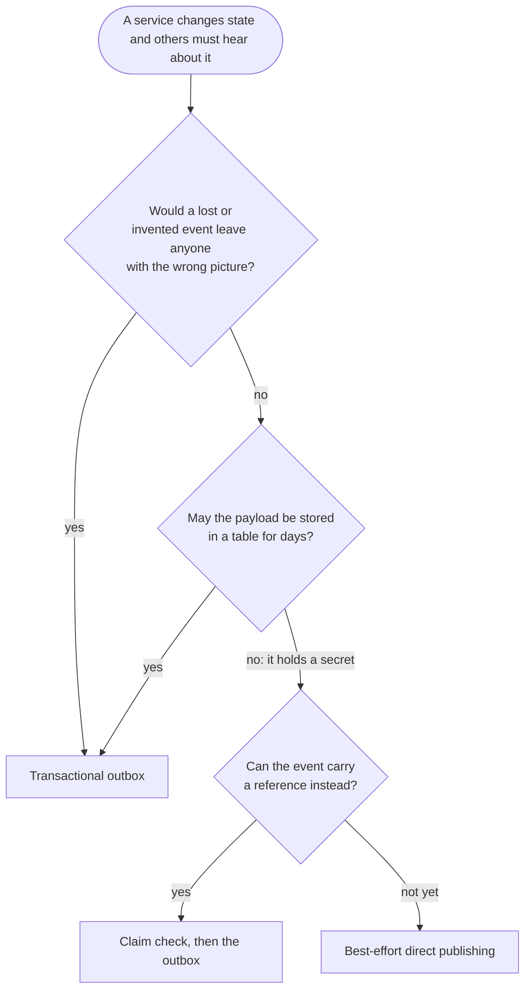
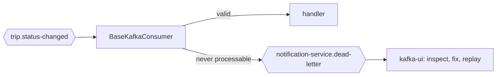
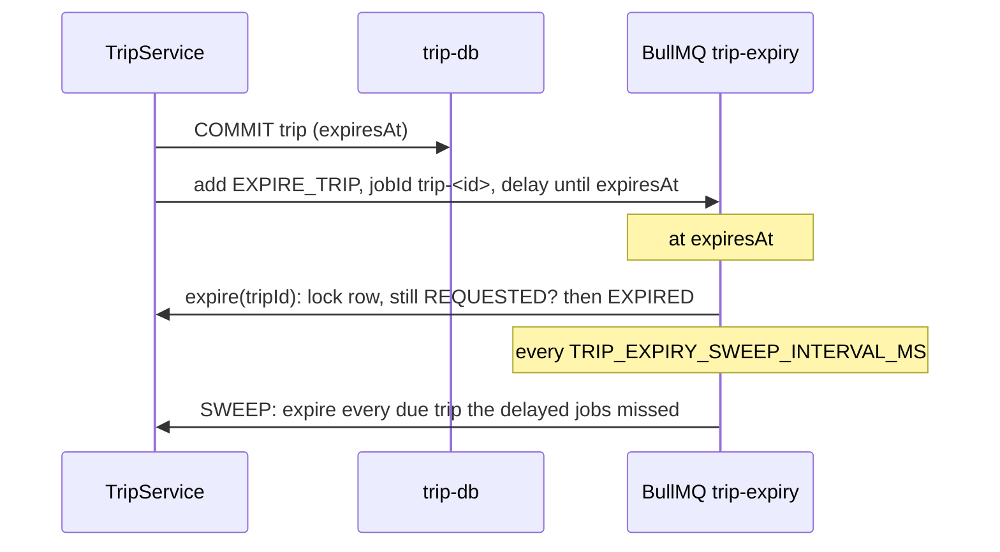
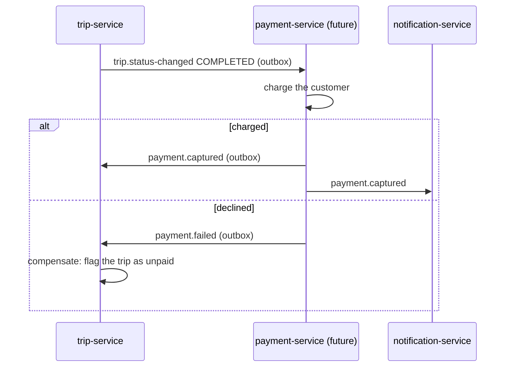
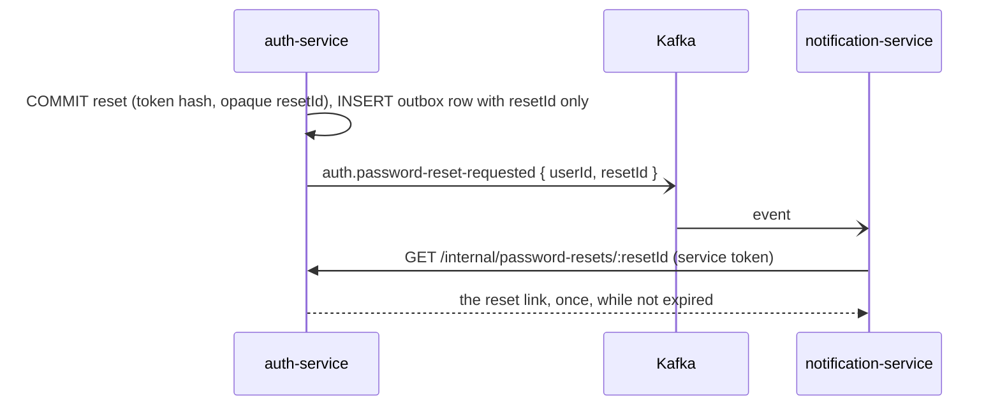

# Reliable messaging patterns

masr3 is a set of services that each own a database and talk through Kafka. That raises the same
few problems again and again: a change and its event must not drift apart, a consumer must
survive duplicates and bad messages, work must happen later or across services, and a retried
request must not act twice. This page lists the patterns that solve them, which ones masr3 uses
and where, and which ones are candidates for later.

The transactional outbox, the pattern masr3 relies on most, has its own page:
[Transactional outbox](transactional-outbox.md).

**Status:** ✅ used · 🟡 partly used · ⬜ not used yet (see [Planned](#planned)) · ⛔ avoided on
purpose.

## Contents

- [At a glance](#at-a-glance)
- [Choosing how to publish](#choosing-how-to-publish)
- [1. Publishing a change and its event together](#1-publishing-a-change-and-its-event-together)
- [2. Consuming events](#2-consuming-events)
- [3. Work across time and across services](#3-work-across-time-and-across-services)
- [4. Requests and concurrency](#4-requests-and-concurrency)
- [Planned](#planned)
- [Further reading](#further-reading)

## At a glance

| Pattern                                                                             | Problem it solves                                        | Status | In masr3                                                        |
| ----------------------------------------------------------------------------------- | -------------------------------------------------------- | ------ | --------------------------------------------------------------- |
| [Transactional outbox](#transactional-outbox)                                       | A change committed but its event lost, or the reverse    | ✅     | auth, trip, vehicle (`@masr3/libs/outbox`)                      |
| [Best-effort direct publishing](#best-effort-direct-publishing)                     | An event too sensitive to store, whose loss is harmless  | ✅     | `auth.password-reset-requested` only                            |
| [Change data capture](#change-data-capture)                                         | Polling the outbox costs latency and queries             | ⬜     | —                                                               |
| [Event sourcing](#event-sourcing)                                                   | State and history as one stream                          | ⛔     | —                                                               |
| [Two-phase commit](#two-phase-commit)                                               | One transaction across the database and the broker       | ⛔     | —                                                               |
| [Idempotent consumer](#idempotent-consumer-and-inbox)                               | The same event delivered twice                           | 🟡     | audit, notification, vehicle (each its own way)                 |
| [Poison messages and a dead-letter topic](#poison-messages-and-a-dead-letter-topic) | A message that can never be handled blocks or vanishes   | 🟡     | skipped and logged by `BaseKafkaConsumer`; no dead-letter topic |
| [Retry topics](#retry-topics)                                                       | A slow failure blocks its whole partition                | ⬜     | —                                                               |
| [Per-key ordering](#per-key-ordering)                                               | One aggregate's events arriving out of order             | ✅     | keys, one relay per service, one request in flight              |
| [Event-carried state transfer](#event-carried-state-transfer-and-read-models)       | A service needs another's data without calling it        | ✅     | `auth.user-changed` → vehicle-service `drivers`                 |
| [Event versioning](#event-versioning)                                               | Producers change events while consumers still run        | ✅     | `schemaVersion`, tolerant DTOs                                  |
| [Delayed job with a sweep](#delayed-job-with-a-sweep)                               | Work that must happen at a later moment                  | ✅     | trip expiry, notification deliveries (BullMQ)                   |
| [Saga](#saga)                                                                       | A business transaction spanning services                 | ⬜     | —                                                               |
| [Claim check](#claim-check)                                                         | An event that must not carry its content                 | ⬜     | —                                                               |
| [Idempotency key](#idempotency-key)                                                 | A retried HTTP request acting twice                      | ⬜     | —                                                               |
| [Circuit breaker and timeouts](#circuit-breaker-and-timeouts)                       | A slow dependency exhausting the caller                  | ⬜     | —                                                               |
| [Locking](#locking)                                                                 | Two writers changing the same row or doing the same work | ✅     | `FOR UPDATE` row locks, `pg_try_advisory_xact_lock`             |

## Choosing how to publish



Default to the outbox. Direct publishing is the exception, and in masr3 there is exactly one.

## 1. Publishing a change and its event together

The core problem: a database commit and a Kafka send are two separate systems, so either can
succeed while the other fails.

| Order             | Failure                                       | Result                                                            |
| ----------------- | --------------------------------------------- | ----------------------------------------------------------------- |
| Commit, then send | Kafka is down, or the process dies in between | **Lost event.** The trip changed and nobody was told.             |
| Send, then commit | The commit fails or rolls back                | **Phantom event.** Consumers act on a change that never happened. |

### Transactional outbox

✅ **Used by auth-service, trip-service and vehicle-service.**

The event is written as a row in `outbox_events`, in the same transaction as the change. A relay
later copies pending rows to Kafka. The row exists if and only if the change committed, which
removes both failures above.

```mermaid
sequenceDiagram
  participant S as Service
  participant DB as Postgres
  participant R as Relay (BullMQ RELAY job)
  participant K as Kafka
  S->>DB: BEGIN, UPDATE trips, INSERT outbox_events, COMMIT
  R->>DB: every OUTBOX_POLL_INTERVAL_MS: lock, read pending rows by id
  R->>K: sendBatch, keyed by aggregate id
  alt sent
    R->>DB: SET publishedAt
  else Kafka fails
    R->>DB: attempts + 1, lastError; retried next tick
  end
```

- **Where:** `OutboxModule.forRoot({ queue })` from `@masr3/libs/outbox` in each `AppModule`;
  features inject `OutboxService<OutboxEventMap>` and call `enqueue(manager, topic, payload, key)`
  with the transaction's `manager`.
- **Guarantees:** at least once, never invented, in order per key. Consumers must therefore be
  idempotent (below).
- **Costs:** an extra table and row per event, latency up to `OUTBOX_POLL_INTERVAL_MS`, and one
  relay per service (about `OUTBOX_BATCH_SIZE` events per tick).
- **Details:** relay steps, retention, failure handling and how to adopt it are in
  [Transactional outbox](transactional-outbox.md).

### Best-effort direct publishing

✅ **Used for one event: `auth.password-reset-requested`.**

The service sends to Kafka after its commit and logs a failure instead of throwing it. A Kafka
outage then loses the event, but never fails the request.

- **Why only this one:** it carries the raw reset token. Through the outbox, the token would sit
  in `outbox_events` for the whole retention (7 days). If it is lost, the user asks for another
  email, and nothing is corrupted.
- **Where:** `KafkaPublisherService` in auth-service. Its `publish()` accepts only
  `DirectAuthKafkaTopic`, so no other topic can drift onto this path. The topic keeps messages
  for one hour.
- **Rule:** only for events whose loss is harmless _and_ that must not be stored. Everything else
  goes through the outbox. The [claim check](#claim-check) would remove this last exception.

### Change data capture

⬜ **Not used.** A candidate only if polling becomes a measured bottleneck.

Instead of polling `outbox_events`, a connector reads Postgres's write-ahead log through logical
replication and streams each new outbox row to Kafka as it commits. The usual tool is Debezium on
Kafka Connect with its outbox event router.

| Gains                                     | Costs                                                                          |
| ----------------------------------------- | ------------------------------------------------------------------------------ |
| Milliseconds instead of a poll interval   | Kafka Connect and Debezium to run and monitor                                  |
| No polling queries, no relay job, no lock | `wal_level=logical` and a replication slot per database                        |
| No relay throughput ceiling               | A direct connection to Postgres: pgbouncer's transaction mode cannot replicate |
|                                           | A stopped connector keeps its slot, so the WAL grows until the disk fills      |

The outbox table stays exactly as it is, so moving to change data capture later changes only the
relay, not the services.

### Event sourcing

⛔ **Not planned.**

Events are the source of truth, and tables are projections rebuilt from them, so the change and
its event cannot drift because they are the same write. It also gives a complete history. The
price is a different programming model: every read goes through projections, schemas must evolve
as event versions, and fixing bad data means writing compensating events. masr3's history needs
are covered by `trip_status_history` and the audit trail.

### Two-phase commit

⛔ **Avoided.**

A coordinator commits the database and the broker together (XA). Kafka does not take part in XA
transactions, and two-phase commit blocks every participant when the coordinator fails. The
outbox exists to get the same result without it.

## 2. Consuming events

The outbox guarantees each event at least once and in order per key. The consumer has to cope
with the rest.

### Idempotent consumer and inbox

🟡 **Every consumer is idempotent, each in its own way. There is no shared inbox table.**

A redelivered event (the relay resent a batch, or Kafka redelivered after a rebalance) must have
no second effect.

| Consumer             | How it ignores a duplicate                                                                                                                          |
| -------------------- | --------------------------------------------------------------------------------------------------------------------------------------------------- |
| audit-service        | `eventId` is unique (`UQ_audits_event_id`). It inserts first; `isUniqueViolation` means the event was already recorded.                             |
| notification-service | Each intent's `dedupeKey` is `<eventId>:<type>:<userId>`, unique in `notifications` (`UQ_NOTIFICATIONS_DEDUPE_KEY`), so a resend can't email twice. |
| vehicle-service      | `auth.user-changed` is a full snapshot applied as an upsert on `userId`, or a delete. Applying it twice leaves the same row.                        |

**The inbox** is the general form: a `processed_events (eventId PRIMARY KEY, topic, processedAt)`
table, inserted in the same transaction as the handler's writes. A duplicate fails the insert and
the handler is skipped. It's worth adding when a handler's effect has no natural unique key of its
own. Until then, the per-consumer keys above do the same job with one table less.

### Poison messages and a dead-letter topic

🟡 **Bad messages are skipped and logged; they are not kept anywhere.**

`BaseKafkaConsumer` sorts every failure into one of two kinds:

| Kind                                                                       | What happens                                                   | Why                                        |
| -------------------------------------------------------------------------- | -------------------------------------------------------------- | ------------------------------------------ |
| **Can never succeed:** unknown topic, empty value, bad JSON, fails its DTO | Logged with the failing fields, offset committed, message gone | Retrying would block the partition forever |
| **Might succeed later:** the handler throws (database down, a bug)         | Rethrown; the offset is not committed and kafkajs retries      | The event must not be lost                 |

The gap is in the first row: a skipped message survives only as a log line. A **dead-letter
topic** keeps it:



- **Design for masr3:** one dead-letter topic per consuming service (for example
  `notification-service.dead-letter`), created by that service's `kafka:create-topics`. The
  message is the original value, unchanged, with headers for its source topic, partition, offset
  and the reason. `BaseKafkaConsumer` sends there instead of only logging, so every consumer gets
  it at once.
- **Replay:** fix the producer or the DTO, then copy the messages back to their source topic.
  Consumers are idempotent, so a replay is safe.
- **Watch it:** a dead-letter topic that silently fills is no better than a log. Alert when it
  receives anything.

### Retry topics

⬜ **Not used.**

Today a handler failure is retried in place: the consumer keeps retrying that message, and every
later message in its partition waits behind it. With retry topics, the failed message moves to
`<topic>.retry.1m`, then `.retry.10m`, and finally to the dead-letter topic, while the partition
moves on.

The catch is that it **breaks per-key ordering**: a later event for the same trip can overtake
the one being retried. That's acceptable for independent events, such as sending a single email,
and wrong for status changes. masr3's handlers only write to their own database, where in-place
retries are the right choice. Revisit this if a handler starts calling slow external APIs.

### Per-key ordering

✅ **Each aggregate's events arrive in the order they happened.**

Kafka orders messages only within a partition, so ordering takes several pieces working together:

1. **Key by aggregate:** `userId` for `auth.*`, `tripId` for `trip.status-changed`, and
   `<ENTITY>-<id>` for audit events. One key always lands on one partition.
2. **One topic per aggregate** when consumers need order across event types, such as
   `trip.status-changed` for every status, rather than a topic per status.
3. **One relay per service:** `pg_try_advisory_xact_lock(OUTBOX_RELAY_LOCK_ID)` plus BullMQ
   concurrency 1, and rows read in id order.
4. **One request in flight** (`maxInFlightRequests: 1`) with an idempotent producer, so a retried
   send can't overtake a later one.
5. **One partition at a time per consumer instance** (kafkajs default), processed in offset order.

There's no order across topics or across aggregates, and nothing should rely on one.

### Event-carried state transfer and read models

✅ **vehicle-service keeps its own copy of drivers.**

Rather than calling auth-service whenever it needs a driver's name, vehicle-service consumes
`auth.user-changed`, which carries the user's whole current state, and keeps a `drivers` table:
a read model, also called a materialised view.

- **Snapshots, not diffs:** a consumer only overwrites or deletes its row, so it never has to
  rebuild state, and a duplicate is harmless.
- **Bootstrapping:** the consumer reads from the beginning of the topic, and
  `users:publish-snapshots` publishes every existing user once, for users created before the
  topic existed.
- **Trade-off:** the copy is eventually consistent, so it can lag auth-service by a relay tick.
  That's why vehicles reference drivers without a foreign key.

### Event versioning

✅ **Contracts change without stopping consumers.**

- **Contracts in one place:** the topic enums and payload interfaces in
  `libs/src/lib/kafka/<domain>/`, so a producer and its consumers compile against the same shape.
- **Tolerant reader:** consumer DTOs use `@IsString` rather than `@IsEnum` for values a producer
  may extend, and audit-service stores its classifier columns as `varchar`. A new action, status
  or role reaches the handler instead of being dropped.
- **Explicit versions:** the audit envelope carries `schemaVersion`
  (`AUDIT_EVENT_SCHEMA_VERSION`). A breaking change bumps it; the consumer is released first and
  accepts both versions, then the producers switch.
- **Adding a field is safe; renaming or removing one is a breaking change.** Prefer a new optional
  field over changing an old one.

## 3. Work across time and across services

### Delayed job with a sweep

✅ **Trip expiry and notification deliveries.**

Work that must happen at a later moment is a BullMQ delayed job with a stable id, backed by a
scheduled sweep that catches anything the delayed job missed.



- **Queued after the commit**, never inside the transaction, so a rolled-back trip has no job.
  Queuing can still fail after the commit: the sweep is the safety net.
- **Safe to run twice:** both paths go through the same locked `TripService.transition`, and a
  stable `jobId` stops a second job for the same trip being queued.
- notification-service does the same with `delivery-<id>` jobs (5 attempts, exponential backoff)
  and `notification-delivery-sweep`.

### Saga

⬜ **Not needed yet. It will be once a trip involves payments.**

A business transaction that spans services can't be one database transaction. A saga splits it
into local transactions, one per service, each publishing an event through its outbox. When a
step fails, earlier steps are undone by **compensating** transactions, such as a refund for a
charge.



- **Choreography** (above): each service reacts to the previous one's event. There's no central
  coordinator, but the flow is spread across services.
- **Orchestration:** one service, or a workflow engine, drives the steps and stores the saga's
  state. It's easier to follow and change once there are more than three or four steps.
- **What a saga does not give you:** isolation. Others can see the intermediate states (charged
  but not yet confirmed), so design statuses for them.

### Claim check

⬜ **The planned fix for the password-reset token.**

The event carries a reference instead of its content, and the consumer fetches the content when
it needs it. For password resets:



The secret never reaches Kafka or `outbox_events`, so the event can go through the outbox like
every other one, and `KafkaPublisherService` can be removed. The same pattern fits large payloads,
such as a generated PDF report: store the file and send its key.

## 4. Requests and concurrency

### Idempotency key

⬜ **Recommended before a mobile client goes live.**

A client that times out and retries `POST /api/trips` creates two trips. With an idempotency key,
the client sends a unique `Idempotency-Key` header per logical request, and the server stores the
first response under it:

1. In one transaction, insert `(userId, key, requestHash)` into an `idempotency_keys` table
   (unique on `userId, key`), then do the work and store the response.
2. A retry with the same key and the same body gets the stored response, without acting again.
   The same key with a different body is a `422`.
3. Keys expire after a day, removed by a BullMQ sweep.

The candidates are `POST /trips`, `POST /trips/:tripId/offers`, offer acceptance and, later,
anything that charges money.

### Circuit breaker and timeouts

⬜ **Not used.**

When a dependency is slow, every call to it holds a connection and a request until it times out,
and the caller degrades too. Three measures limit the damage:

- **Timeouts** on every outgoing call, shorter than the caller's own deadline.
- **A circuit breaker:** after repeated failures, fail fast for a cool-down period instead of
  calling, then let a trial call through.
- **A bulkhead:** cap how many calls to one dependency run at once.

In masr3 the only synchronous call between services is notification-service asking auth-service
for a user's contact details (`/internal/users/:id/contact`). It's made in two places, with
different fallbacks:

- **In the `trip.status-changed` handler** (`TripEventsHandler`): a failure is rethrown, so Kafka
  retries the message in place, and that partition waits until auth-service answers. This is
  where a timeout and a breaker would help first.
- **When resolving a delivery's recipient** (`RecipientService`): a failure is recorded on the
  delivery row and BullMQ retries it with backoff, which is already a reasonable fallback.

A breaker becomes worth it as synchronous calls multiply.

### Locking

✅ **Pessimistic row locks for state changes, advisory locks for singleton work.**

| Lock                             | Where                                                                              | Why                                                                |
| -------------------------------- | ---------------------------------------------------------------------------------- | ------------------------------------------------------------------ |
| `SELECT … FOR UPDATE` on one row | `TripService.transition`, `VehicleService.changeStatus`, `UsersService.lockOrFail` | Two requests can't both validate the same old state and both write |
| `pg_try_advisory_xact_lock(id)`  | the outbox relay                                                                   | One relay per service at a time, which keeps events in order       |

Both are released at commit, so they work through pgbouncer's transaction mode. Session-level
locks (`pg_advisory_lock`) would not.

The alternative is **optimistic concurrency**: a `version` column, and an update that fails when
someone else changed the row first. It holds no lock while the request runs and suits rows that
are rarely contended and long user edits. masr3's state changes are short and contended (two
drivers accepting one trip), where a row lock is simpler.

## Planned

In the order I'd add them:

1. **Dead-letter topic in `BaseKafkaConsumer`.** One change in libs, and every consumer keeps its
   unprocessable messages instead of dropping them.
2. **Idempotency keys** on trip and offer creation, before mobile clients.
3. **Claim check for password resets.** The last direct event moves to the outbox, and the token
   stays out of Kafka.
4. **Sagas,** with the first payment flow.
5. **Change data capture,** only if the polling relay becomes a measured bottleneck.

## Further reading

- Chris Richardson, [microservices.io patterns](https://microservices.io/patterns/): transactional
  outbox, polling publisher, transaction log tailing, saga, idempotent consumer.
- [Debezium outbox event router](https://debezium.io/documentation/reference/stable/transformations/outbox-event-router.html),
  for change data capture of an outbox table.
- Gregor Hohpe and Bobby Woolf, _Enterprise Integration Patterns_: claim check, dead letter
  channel, idempotent receiver.
- [The Idempotency-Key HTTP header](https://datatracker.ietf.org/doc/draft-ietf-httpapi-idempotency-key-header/),
  the IETF draft.
