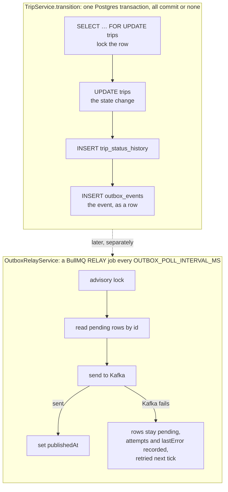

# Transactional outbox

How a masr3 service publishes Kafka events that must never be lost or invented. The outbox lives
in libs (`libs/src/lib/outbox/`): `OutboxModule`, `OutboxService`, the relay and the
`outbox_events` entity. auth-service, trip-service and vehicle-service register it. Any service
with events that matter can, and **every service that produces audit events must** (see
[audit-service](../services/audit-service.md)).

## The problem: a dual write

A state change that also publishes an event writes to two systems, Postgres and Kafka. They share
no transaction, so the work can fail half-way in either order:

| Order                   | Failure                                       | Result                                                            |
| ----------------------- | --------------------------------------------- | ----------------------------------------------------------------- |
| Commit to DB, then send | Kafka is down, or the process dies in between | **Lost event.** The trip changed and nobody was told.             |
| Send, then commit to DB | The commit fails or rolls back                | **Phantom event.** Consumers act on a change that never happened. |

Retrying the send in a `catch` doesn't fix the first case: the process can die before it retries.
auth-service's `auth.password-reset-requested` is published best-effort and accepts the first case
(see "When not to use it"); every other event in masr3 goes through an outbox.

## The fix

The service never talks to Kafka inside the business transaction. The event is written as a row
in the **same** transaction as the state change. A separate relay copies rows to Kafka afterwards.



The event row exists **if and only if** the state change committed. That one property removes
both failure cases.

## The relay, step by step

A BullMQ job scheduler (`<queue>-every-interval`) adds a `RELAY` job to the service's relay
queue (the `queue` passed to `OutboxModule.forRoot`) every `OUTBOX_POLL_INTERVAL_MS`, and the
relay processor runs each one. Each run ("tick") is one Postgres transaction:

1. **`SELECT pg_try_advisory_xact_lock(OUTBOX_RELAY_LOCK_ID)`.** If it returns false, another
   instance is relaying right now, so this tick does nothing. Only one relay ever publishes at a
   time, which is what keeps events in order (step 3).
2. **Read up to `OUTBOX_BATCH_SIZE` rows** where `publishedAt IS NULL`, `ORDER BY id`.
3. **Send them in one `sendBatch`**, in id order, with the message key set to the aggregate id
   (`tripId`). Kafka keeps order per partition, and a key always maps to the same partition, so
   one trip's events reach consumers in the order they happened.
4. Then one of:
   - **Success:** set `publishedAt`.
   - **Failure:** increment `attempts` and set `lastError`. The rows stay pending, and the whole
     batch is retried next tick. Newer rows wait behind it (head-of-line blocking) rather than
     overtake it, because skipping would break order.
5. **Purge** rows published more than `OUTBOX_RETENTION_MS` ago.

Ticks don't overlap within an instance: the processor runs with concurrency 1. Across instances
the advisory lock in step 1 does the same job. The producer (`KafkaProducerService` from
`@masr3/libs/kafka`, shared by every service) also helps keep order:

- It is idempotent, with one request in flight, so a kafkajs-level retry can't reorder or
  duplicate messages within a partition.
- It connects lazily, on the first send, so the service boots and keeps accepting writes while
  Kafka is down. auth-service's one best-effort event goes through the same producer.
- Each send retries `KAFKA_PRODUCER_RETRIES` (2) times, then fails. The tick holds its
  transaction open while it sends, so during an outage it records `attempts` / `lastError` and
  ends instead of waiting. An idempotent kafkajs producer otherwise retries without limit,
  whatever the client's `retry` says.

## Guarantees

- **No lost events.** A committed change always has its row, and the row stays pending until
  Kafka accepts it.
- **No phantom events.** A rolled-back change takes its row with it.
- **At-least-once delivery.** If the relay dies after Kafka accepted a batch but before the
  `publishedAt` update committed, that batch is sent again. **Consumers must be idempotent:**
  deduplicate on `eventId`, as notification-service does with its unique `eventId` column.
- **Per-key order.** All events for one aggregate arrive in commit order.

Verified on trip-service:

- Kafka was stopped while trips kept changing. The calls succeeded and the rows waited with
  `attempts` / `lastError`. After a restart they drained in about 2.5 s, in order.
- Two relays ran against one database: 60 events, each published exactly once, 20/20 trips in
  order.

## Costs

- An extra table, and a scheduled BullMQ job, per service. Publishing pauses while Redis is down;
  nothing is lost, because the rows wait in Postgres.
- Latency of up to one poll interval (about 1 s by default) between commit and Kafka.
- A batch that can never be sent (for example a missing topic) blocks everything behind it. That
  is deliberate, and it is visible: `SELECT * FROM outbox_events WHERE "publishedAt" IS NULL ORDER BY id`.
- One Postgres connection is held for the duration of a send. The producer's short retry
  (`retries: 2`) keeps that brief when Kafka is down.

## pgbouncer notes

All services reach Postgres through pgbouncer in `transaction` pool mode. Each server connection
is shared between clients at transaction boundaries.

- **`LISTEN/NOTIFY` is out.** A listener needs a session that stays connected, so the relay polls
  instead.
- **Session advisory locks (`pg_advisory_lock`) are out.** The lock would stay on a pooled
  connection that another client then gets.
- **Transaction advisory locks (`pg_try_advisory_xact_lock`) are fine.** Postgres releases them at
  `COMMIT` / `ROLLBACK`, inside the same transaction pgbouncer pins.

## Adopting it in another service

1. **Contract in `libs/src/lib/kafka/<domain>/`:** a topic enum, payloads that extend
   `BaseKafkaEvent` (`eventId`, `occurredAt`), and an `<Domain>EventMap`.
2. **Event map:** `src/kafka/kafka.interface.ts` declares `OutboxEventMap`, every topic
   the service publishes through its outbox (for example `TripEventMap & AuditEventMap`).
3. **Register the module once, in `AppModule`:**

   ```ts
   OutboxModule.forRoot({ queue: TRIP_OUTBOX_RELAY_QUEUE }),
   ```

   It is global and brings the shared Kafka producer with it. `queue` is the service's relay
   queue, a constant in `kafka/kafka.constant.ts`; `queue/queue.module.ts` gives BullMQ its Redis
   connection.
   - **The queue name must be unique to the service**: lowercase kebab-case with the service
     prefix (`auth-outbox-relay`, `trip-outbox-relay`, `vehicle-outbox-relay`); `forRoot` throws
     at boot on anything else (`QUEUE_NAME_PATTERN`). Every service shares one Redis with
     BullMQ's default prefix, so two services with the same name would share one queue: each
     worker would take the other's relay jobs.
   - It is a constant, not env: BullMQ needs the name while the module graph is built, before
     `ConfigService` exists, and it doesn't vary between environments.

4. **Table and migration:** add `OutboxEventEntity` (from `@masr3/libs`) to `database.module.ts`
   and `data-source.ts`, then `migrate-generate` with the CLI.
5. **Enqueue inside the business transaction:** inject `OutboxService<OutboxEventMap>` and call
   `outboxService.enqueue(manager, topic, event, key)` with the **transaction's** `manager`, never
   a repository. Otherwise the row escapes the transaction. The map type makes an unknown topic or
   a wrong payload a compile error.
6. **Env** (required): `KAFKA_BROKER`, `KAFKA_CLIENT_ID`, `REDIS_HOST`, `REDIS_PORT`,
   `OUTBOX_POLL_INTERVAL_MS`, `OUTBOX_BATCH_SIZE`, `OUTBOX_RETENTION_MS`, and the service's own
   `OUTBOX_RELAY_LOCK_ID`.
   - **The lock id is the service port plus three digits** (7000001, 7002001, 7004001). Advisory
     locks are per database, so this only matters if two services ever share one, but distinct ids
     cost nothing.
7. **Topic:** add a `kafka:create-topics` target for the topics this service owns. Topics are
   never auto-created. `audit.action-recorded` is created by audit-service.
8. **Consumers:** deduplicate on `eventId`, or apply snapshots idempotently.

## When not to use it

When a dropped event is acceptable and the event must not be stored. auth-service's
`auth.password-reset-requested` is the example: it carries the raw reset token, which the outbox
would keep in `outbox_events` for the whole retention. If Kafka is down the reset email never goes
out, the user asks again, and nothing is corrupted, so auth-service publishes it directly and logs
failures. Use the outbox when a lost or phantom event would leave another service, or a user,
with the wrong picture of the system: a trip accepted, a payment captured, a "your password was
changed" notice.
