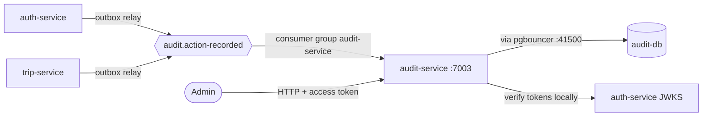
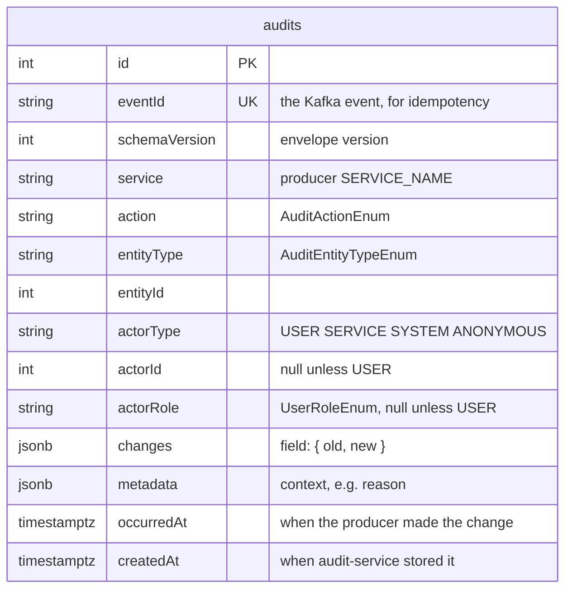
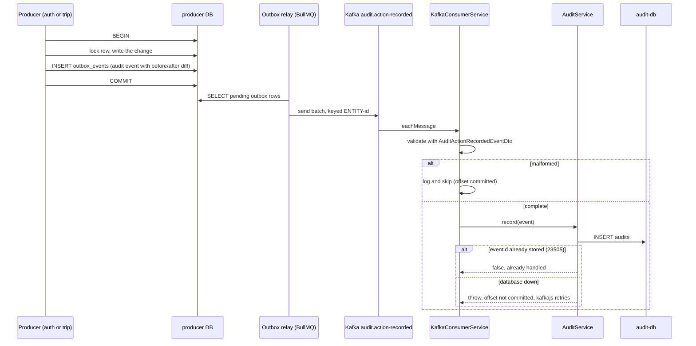
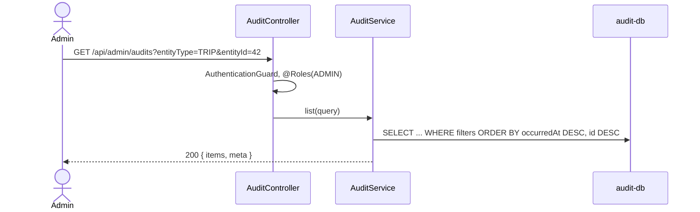

# audit-service

Keeps the audit trail: who did what to which entity, when, and which fields changed, for every
service. It is a pure consumer. Producers write an audit event into their own transactional
outbox in the same transaction as the change. audit-service reads the `audit.action-recorded`
topic and stores each event once. Admins read the trail over HTTP.

- **Port** 7003, database `audit-db` (41003), Swagger at `http://localhost:7003/api/docs`.
- **Owns:** the `audits` table and the `audit.action-recorded` topic (it creates the topic).
- **Does not own:** any business data. It never calls another service; everything it knows
  arrives in the event.

## Context



## Data model



- **Idempotent:** `UQ_audits_event_id` on `eventId`. Kafka delivers at least once, and an
  outbox relay can resend a batch, so the same event can arrive twice. The second insert hits
  `23505` and is treated as already handled.
- **`varchar`, not Postgres enums,** for `service`, `action`, `entityType`, `actorType` and
  `actorRole`. This is a deliberate exception to the repo rule. Producers add new values to the
  libs enums. With an enum column, an unknown value would fail the insert, the consumer would
  rethrow, and the whole partition would stall until audit-service ran a migration. TypeScript
  still types the columns with the libs enums.
- **Append-only:** no `updatedAt`, nothing updates or deletes a row.
- **Indexes** serve the filters: `(entityType, entityId, occurredAt)` for one entity's history,
  `(actorId, occurredAt)` for everything one user did, `(service, occurredAt)` and
  `(action, occurredAt)`.
- The first migration (`create-audit-tables`) created an `audit_log` table that nothing uses
  any more; `create-audits` replaced it with `audits`.

## The event

One topic, one generic envelope, `AuditActionRecordedEvent` (`libs/src/lib/kafka/audit/`):

```ts
{
  eventId, occurredAt,                // filled by createKafkaEvent
  schemaVersion: 1,                   // AUDIT_EVENT_SCHEMA_VERSION
  service: 'trip-service',            // the producer's SERVICE_NAME
  action: 'STATUS_CHANGED',      // AuditActionEnum
  entity: { type: 'TRIP', id: 42 },   // AuditEntityTypeEnum + id
  actor: { type: 'USER', id: 7, role: 'DRIVER' },
  changes: { status: { old: 'REQUESTED', new: 'ACCEPTED' } },
  metadata: { reason: null, acceptedOfferId: 12 },
}
```

- **Keyed by entity** (`buildAuditEventKey` → `TRIP-42`), so one entity's history stays on one
  partition and is stored in order.
- **Diffs come from the producer.** Only the producer knows the old value at the moment it
  writes, so it builds `changes` with `buildAuditChanges(before, after, FIELDS)`. The explicit
  field allow-list means a password hash or a reset token can never reach the audit trail.
- **An action is a verb; the entity says what it applies to.** `AuditActionEnum` holds
  `CREATED`, `UPDATED`, `DELETED`, `STATUS_CHANGED` (shared by every entity) and
  entity-specific verbs (`LOGGED_IN`, `SUBMITTED`…). A row is read as `entityType` + `action`
  (TRIP + STATUS_CHANGED), never the action alone. A new entity usually needs only an
  `AuditEntityTypeEnum` value.
- **A new audited action needs no change here.** The producer adds an `AuditActionEnum` value
  and publishes it; audit-service stores whatever arrives.
- **Actors:** `buildUserAuditActor(user)` for a signed-in user, `SYSTEM_AUDIT_ACTOR` for jobs
  (trip expiry), `ANONYMOUS_AUDIT_ACTOR` for unauthenticated requests (forgot-password).

### What is audited today

| Producer     | Entity       | Actions                                                                                                                                                                |
| ------------ | ------------ | ---------------------------------------------------------------------------------------------------------------------------------------------------------------------- |
| auth-service | `USER`       | `REGISTERED`, `LOGGED_IN`, `LOGGED_OUT`, `PASSWORD_CHANGED`, `PASSWORD_RESET_REQUESTED`, `PASSWORD_RESET_COMPLETED`, `CREATED`, `UPDATED`, `STATUS_CHANGED`, `DELETED` |
| trip-service | `TRIP`       | `CREATED`, `STATUS_CHANGED` (every transition, including SYSTEM expiry)                                                                                                |
| trip-service | `TRIP_OFFER` | `SUBMITTED`, `WITHDRAWN`                                                                                                                                               |

`AuditEntityTypeEnum` also lists notification-service's `NOTIFICATION`,
`NOTIFICATION_DELIVERY` and `NOTIFICATION_PREFERENCE`. Nothing produces them yet: that needs
an outbox in notification-service (see Planned). The enum leaves out `audits`,
`trip_status_history` (already covered by the trip's `STATUS_CHANGED`) and `outbox_events`.

Accepting, rejecting and expiring offers happen inside a trip transition, so they appear as
that trip's `STATUS_CHANGED` (with `acceptedOfferId` in `metadata`).

## Flows

### Recording an action



- The entry exists **exactly when the change does**. The outbox row commits or rolls back with
  the change. The relay retries until Kafka accepts. The consumer only commits an offset after
  the row is stored.
- `fromBeginning: true`: a new consumer group (first run, or a renamed group id) starts at the
  oldest message still on the topic. Replays are harmless because of `UQ_audits_event_id`.

### Reading the trail



## API

All routes are `@Roles(ADMIN)`. Anyone else gets `403`.

| Route                       | What                                    |
| --------------------------- | --------------------------------------- |
| `GET /api/admin/audits`     | Paginated list, newest first, filtered  |
| `GET /api/admin/audits/:id` | One entry with its changes and metadata |
| `GET /api/health`           | Public liveness check                   |

Filters on the list, all optional and combinable:

| Query                        | Example                | Meaning                                            |
| ---------------------------- | ---------------------- | -------------------------------------------------- |
| `service`                    | `trip-service`         | The producer's `SERVICE_NAME`                      |
| `action`                     | `DELETED`              | `AuditActionEnum`; alone, across every entity type |
| `entityType`, `entityId`     | `TRIP`, `42`           | Together: one entity's whole history               |
| `actorType`                  | `SYSTEM`               | `USER`, `SERVICE`, `SYSTEM`, `ANONYMOUS`           |
| `actorId`                    | `7`                    | Everything one user did                            |
| `actorRole`                  | `ADMIN`                | Everything done by admins                          |
| `occurredFrom`, `occurredTo` | `2026-10-01T00:00:00Z` | ISO 8601, inclusive, on `occurredAt`               |
| `page`, `limit`              | `1`, `20` (max 100)    | Pagination                                         |

## Kafka

- **Topic:** `audit.action-recorded`, 3 partitions. Created by
  `npx nx run audit-service:kafka:create-topics` (`scripts/kafka-create-topics.sh`). Producers
  can't publish until it exists (`allowAutoTopicCreation: false`); their outbox rows stay
  pending and go out once it does.
- **Consumer group:** `KAFKA_CONSUMER_GROUP_ID=audit-service`. Every audit-service instance
  shares it, so the partitions are split between them and each event is stored by exactly one
  instance. A different group id would be a separate reader that receives everything again.
- **Failures** follow the repo rule. A message that can never be stored is logged with the
  failing fields and skipped: bad JSON, or an envelope that fails `AuditActionRecordedEventDto`
  (class-validator), e.g. a missing field, an `occurredAt` that is not ISO 8601, or an id beyond
  Postgres `int`. Letting such a message reach the insert would fail it, rethrow, and stall the
  partition forever. A database error is rethrown, so the offset is not committed and the
  message is retried.
- The DTO checks `service`, `action`, `entityType`, `actorType` and `role` as non-empty strings,
  **not** `@IsEnum`: a value a producer adds before audit-service is redeployed is recorded, not
  skipped and lost.

## Authentication

The shared guard from `@masr3/libs` verifies access tokens locally against auth-service's JWKS
(`AUTH_SERVICE_URL`), see [`docs/authentication.md`](../authentication.md).
`/api/health` is public.

## Planned

- **Retention:** partition `audits` by month and drop or archive old partitions.
- **"My activity":** a user-facing route that lists a user's own actions (`actorId = me`), with
  sensitive actions filtered out.
- **notification-service as a producer:** its entity types are already in
  `AuditEntityTypeEnum`. It needs an outbox, then audits for preference changes
  (`NOTIFICATION_PREFERENCE` `UPDATED`), inbox reads and archives (`NOTIFICATION` `UPDATED`)
  and admin retries (`NOTIFICATION_DELIVERY` `STATUS_CHANGED`). A new service adds its own
  entity types the same way.
- **auth-service domain events** (`auth.*`) still use best-effort direct publishing. Its new
  outbox could carry them too.
- **Drop the unused `audit_log` table** left by the first migration.
