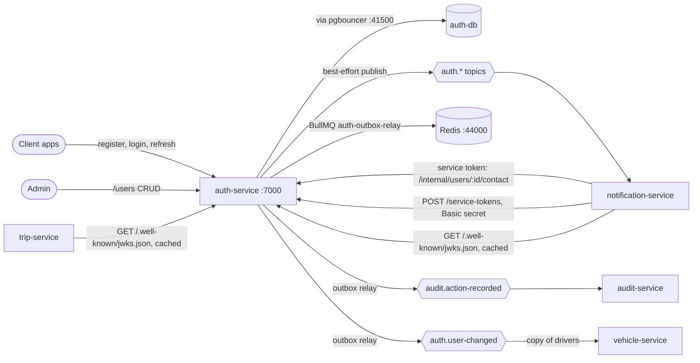
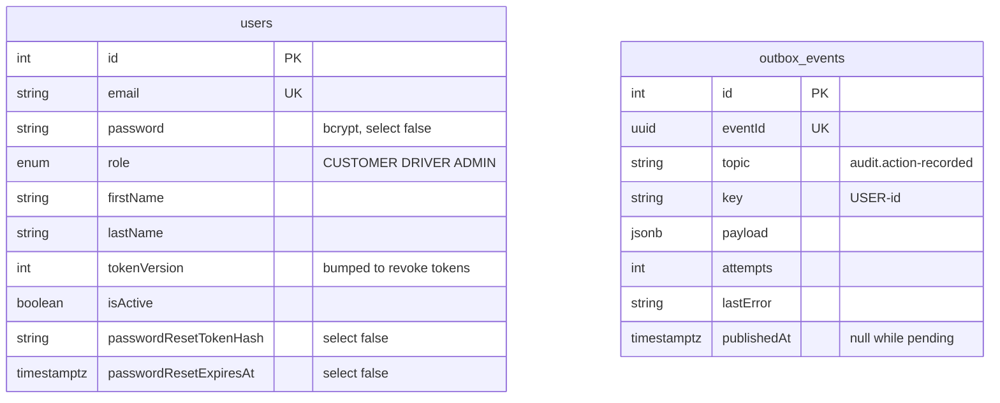
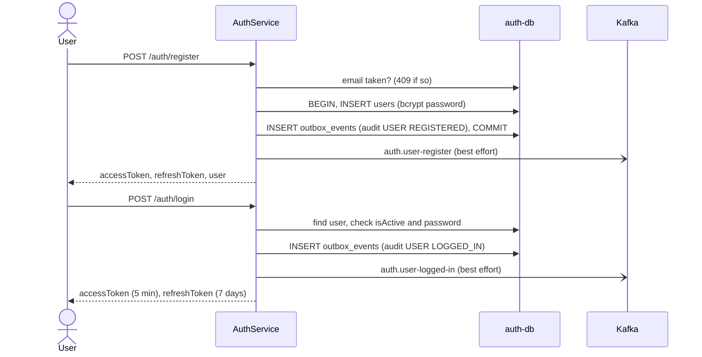
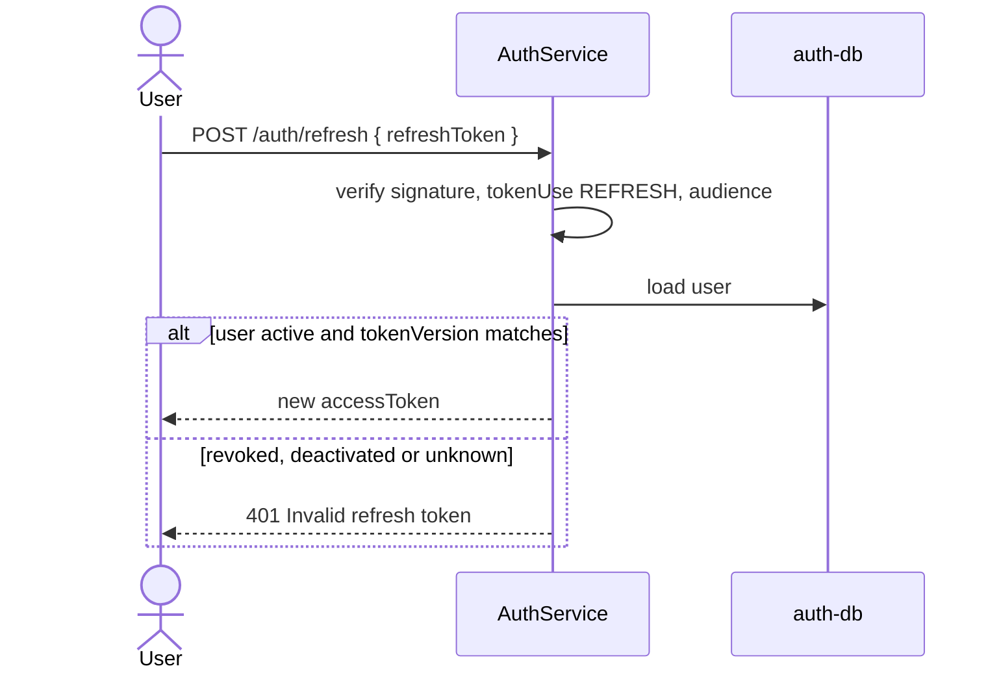
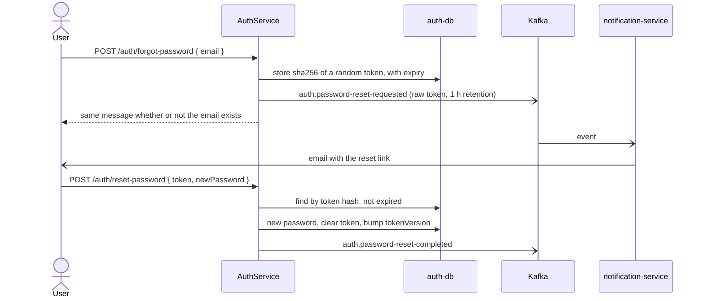
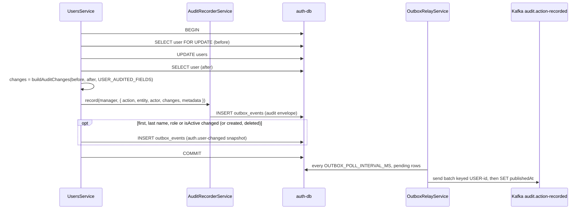
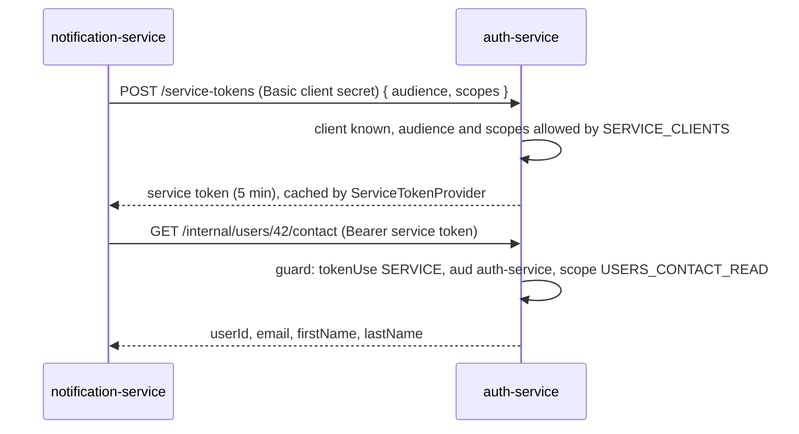

# auth-service

Owns users and every token in masr3. Other services never call it per request: they verify its
RS256 tokens locally against its public keys (JWKS).

- **Port** 7000, database `auth-db` (41000), Swagger at `http://localhost:7000/api/docs`.
- **Owns:** users (roles CUSTOMER, DRIVER, ADMIN), passwords, access / refresh / service tokens,
  signing keys, the service-client registry, and the outbox of its audit and
  `auth.user-changed` events.
- **Does not own:** sending email. It publishes `auth.*` events and notification-service sends.

Token types, claims, scopes, rotation and failure behaviour are covered in depth in
[`docs/authentication.md`](../authentication.md). This page shows how the flows fit together.

## Context

## Data model

- Signing keys are files, not rows: `apps/auth-service/secrets/<name>.{private,public}.pem`,
  created by `npx nx run auth-service:generate-signing-key --name=<name>`.
- Service clients are configuration, not rows: `SERVICE_CLIENTS` lists each caller's allowed
  audiences and scopes; its secret comes from env.

## Flows

### Register and log in

- **Best-effort publishing:** a Kafka outage must not turn register or login into a 500, so
  `publish()` logs and swallows broker failures. The cost: a lost event is a lost email.
- Wrong email and wrong password give the same `401`, so the response doesn't reveal which
  emails exist. Login is rate-limited.

### Refresh and revocation

Logout, a password change or reset, deactivation and a role change bump `tokenVersion`. Every
refresh token dies at once. Access tokens are rejected at once by auth-service, and by other
services when they expire, within 5 minutes.

### Forgot and reset password

Only the token's hash is stored. notification-service stores the email with the token masked.

### Audit events (transactional outbox)

- Every user write in `UsersService` goes through `writeAudited` (or `insert` for a new user),
  so the audit row exists exactly when the change does. Read-only login writes only the outbox
  row.
- `modules/audit/` holds `AuditRecorderService`, the service's one way to produce an audit
  event: it adds `schemaVersion`, `SERVICE_NAME` and the key, then enqueues into the outbox.
  The feature (here `UsersService`) owns the allow-list and the diff.
- `changes` is `buildAuditChanges(before, after, USER_AUDITED_FIELDS)`: email, names, role,
  isActive and tokenVersion. **The password, its hash and the reset token never reach the
  audit trail**, because they are not in the allow-list.
- Actors: the signed-in user (`buildUserAuditActor`), the admin on `/users` routes
  (`@CurrentUser()`), or `ANONYMOUS_AUDIT_ACTOR` for forgot-password.
- The same transaction also enqueues `auth.user-changed` (`UsersService.publishChanged`) when
  a field in `USER_SNAPSHOT_FIELDS` changed, so logins and password changes publish nothing.
- The outbox is the shared one from `@masr3/libs`, on queue `auth-outbox-relay` with advisory
  lock `7000001` (env `OUTBOX_RELAY_QUEUE`, `OUTBOX_RELAY_LOCK_ID`). Redis is shared, so a
  queue without the `auth-` prefix could collide with another service's. See
  [the outbox pattern](../patterns/transactional-outbox.md).

### Service-to-service calls

`/api/internal/*` and `/api/service-tokens` must never be routed by a public ingress.

### How other services verify tokens

Each service registers `AuthenticationModule` and the closed-by-default `AuthenticationGuard`
from `@masr3/libs`. The guard fetches `GET /api/.well-known/jwks.json` once, caches the keys by
`kid`, and verifies every token locally: signature, `iss`, `aud`, `tokenUse`, expiry.

## Routes

| Route (`/api`)                                                              | Who                                 |
| --------------------------------------------------------------------------- | ----------------------------------- |
| `POST /auth/register`, `/login`, `/refresh`                                 | public                              |
| `POST /auth/forgot-password`, `/reset-password`                             | public                              |
| `GET /auth/me`, `POST /auth/change-password`, `/logout`                     | any signed-in user                  |
| `GET/POST /users`, `GET/PATCH/DELETE /users/:id`, `PATCH /users/:id/status` | ADMIN                               |
| `POST /service-tokens`                                                      | service client (Basic)              |
| `GET /internal/users/:id/contact`                                           | service token, `USERS_CONTACT_READ` |
| `GET /.well-known/jwks.json`, `GET /health`                                 | public                              |

## Events

Keyed by `userId`. Contracts: `AuthEventMap` in `libs/src/lib/kafka/auth/`. All are published
best-effort except `auth.user-changed`, which goes through the outbox.

| Topic                           | Published by                                                                     | notification-service sends     |
| ------------------------------- | -------------------------------------------------------------------------------- | ------------------------------ |
| `auth.user-register`            | `register()`                                                                     | welcome email                  |
| `auth.user-logged-in`           | `login()`                                                                        | new sign-in alert              |
| `auth.user-logged-out`          | `logout()`                                                                       | nothing                        |
| `auth.user-change-password`     | `changePassword()`                                                               | "your password was changed"    |
| `auth.password-reset-requested` | `forgetPassword()`                                                               | the reset email                |
| `auth.password-reset-completed` | `resetPassword()`                                                                | "your password has been reset" |
| `auth.user-changed`             | every user write that changes a name, role or `isActive`, plus create and delete | nothing (not subscribed)       |

`auth.user-changed` carries the user's whole state (`userId`, `firstName`, `lastName`, `role`,
`isActive`) and the `change` (`CREATED`, `UPDATED`, `DELETED`), never a diff, so a consumer that
keeps a copy only overwrites or deletes its row. vehicle-service keeps its drivers this way.
Users written before the topic existed are published once with
`npx nx run auth-service:users:publish-snapshots`.

**Audit events** go to `audit.action-recorded` through the outbox, keyed `USER-<id>`, consumed
by [audit-service](audit-service.md), all with `entityType` `USER`: `REGISTERED`,
`LOGGED_IN`, `LOGGED_OUT`, `PASSWORD_CHANGED`, `PASSWORD_RESET_REQUESTED`,
`PASSWORD_RESET_COMPLETED`, and the admin actions `CREATED`, `UPDATED`, `STATUS_CHANGED`,
`DELETED`.

## Planned

- **Move the other `auth.*` events onto the outbox.** Audit events and `auth.user-changed`
  already use it; routing the rest through it too would stop a Kafka outage from losing a
  password-reset email.
- **Admin-created users** (`POST /users`) are saved with the password as given: it is not
  hashed, so such a user cannot log in. Hash it like `register` does.
- **Driver profiles** (licence, documents) may live here or in vehicle-service; undecided.
  Vehicles live in [vehicle-service](vehicle-service.md).
