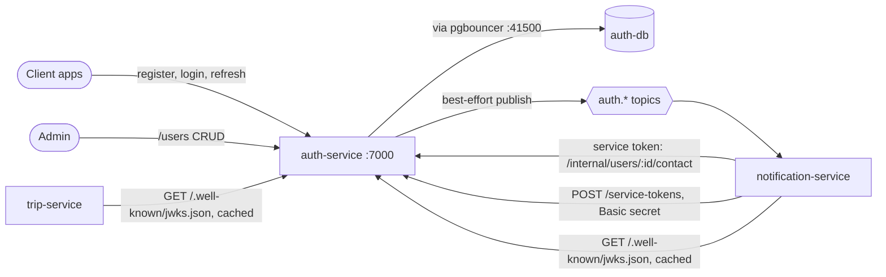
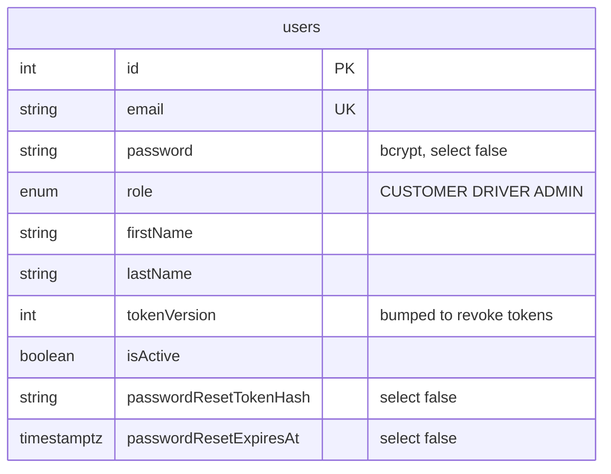
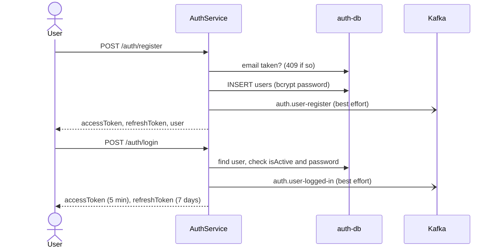
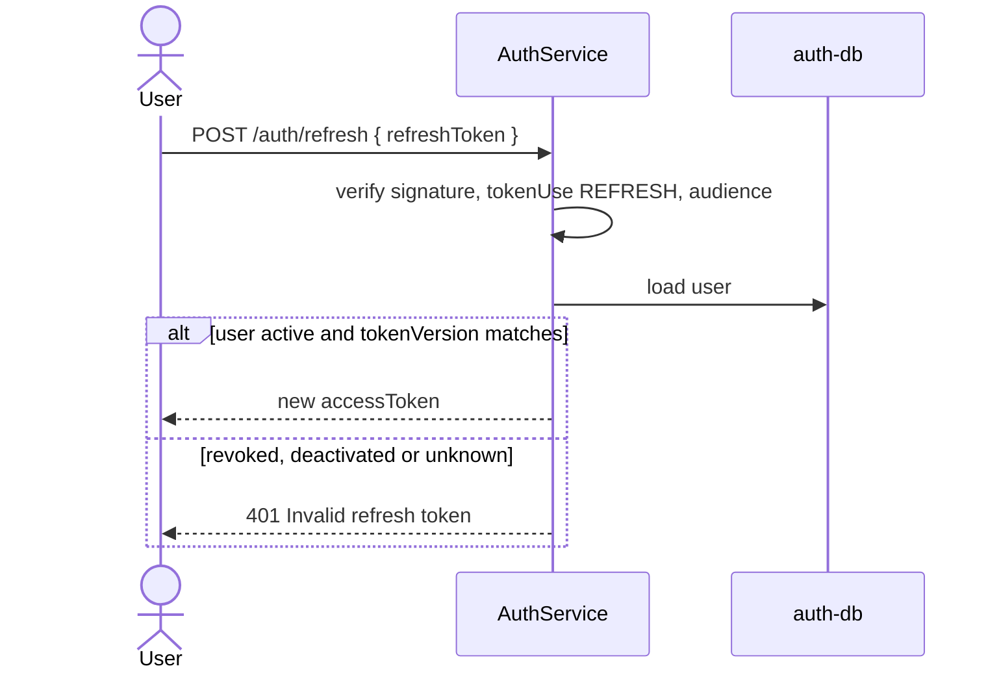
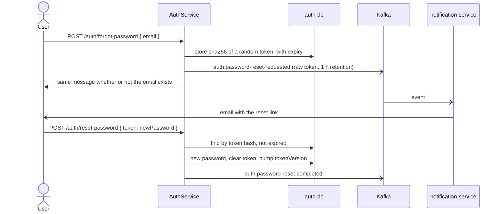
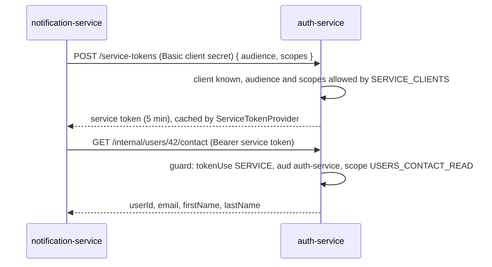

# auth-service

Owns users and every token in masr3. Other services never call it per request: they verify its
RS256 tokens locally against its public keys (JWKS).

- **Port** 7000, database `auth-db` (41000), Swagger at `http://localhost:7000/api/docs`.
- **Owns:** users (roles CUSTOMER, DRIVER, ADMIN), passwords, access / refresh / service tokens,
  signing keys, and the service-client registry.
- **Does not own:** sending email. It publishes `auth.*` events and notification-service sends.

Token types, claims, scopes, rotation and failure behaviour are covered in depth in
[`docs/authentication.md`](../authentication.md). This page shows how the flows fit together.

## Context

## Data model

- Signing keys are files, not rows: `apps/auth-service/secrets/<name>.{private,public}.pem`,
  created by `npx nx run auth-service:generate-signing-key --name=<name>`.
- Service clients are configuration, not rows: `SERVICE_CLIENTS` lists each caller's allowed
  audiences and scopes; its secret comes from env.

## Flows

### Register and log in

- **Best-effort publishing:** a Kafka outage must not turn register or login into a 500, so
  `publish()` logs and swallows broker failures. The cost: a lost event is a lost email.
- Wrong email and wrong password give the same `401`, so the response doesn't reveal which
  emails exist. Login is rate-limited.

### Refresh and revocation

Logout, a password change or reset, deactivation and a role change bump `tokenVersion`. Every
refresh token dies at once. Access tokens are rejected at once by auth-service, and by other
services when they expire, within 5 minutes.

### Forgot and reset password

Only the token's hash is stored. notification-service stores the email with the token masked.

### Service-to-service calls

`/api/internal/*` and `/api/service-tokens` must never be routed by a public ingress.

### How other services verify tokens

Each service registers `AuthenticationModule` and the closed-by-default `AuthenticationGuard`
from `@masr3/libs`. The guard fetches `GET /api/.well-known/jwks.json` once, caches the keys by
`kid`, and verifies every token locally: signature, `iss`, `aud`, `tokenUse`, expiry.

## Routes

| Route (`/api`)                                                              | Who                                 |
| --------------------------------------------------------------------------- | ----------------------------------- |
| `POST /auth/register`, `/login`, `/refresh`                                 | public                              |
| `POST /auth/forgot-password`, `/reset-password`                             | public                              |
| `GET /auth/me`, `POST /auth/change-password`, `/logout`                     | any signed-in user                  |
| `GET/POST /users`, `GET/PATCH/DELETE /users/:id`, `PATCH /users/:id/status` | ADMIN                               |
| `POST /service-tokens`                                                      | service client (Basic)              |
| `GET /internal/users/:id/contact`                                           | service token, `USERS_CONTACT_READ` |
| `GET /.well-known/jwks.json`, `GET /health`                                 | public                              |

## Events

All published best-effort, keyed by `userId`. Contracts: `AuthEventMap` in
`libs/src/lib/kafka/auth/`.

| Topic                           | Published by       | notification-service sends     |
| ------------------------------- | ------------------ | ------------------------------ |
| `auth.user-register`            | `register()`       | welcome email                  |
| `auth.user-logged-in`           | `login()`          | new sign-in alert              |
| `auth.user-logged-out`          | `logout()`         | nothing                        |
| `auth.user-change-password`     | `changePassword()` | "your password was changed"    |
| `auth.password-reset-requested` | `forgetPassword()` | the reset email                |
| `auth.password-reset-completed` | `resetPassword()`  | "your password has been reset" |

## Planned

- **A transactional outbox for `auth.*`**, like trip-service's, so a Kafka outage can no longer
  lose a password-reset email.
- **Driver profiles and vehicles** may live here or in a new service; undecided.
