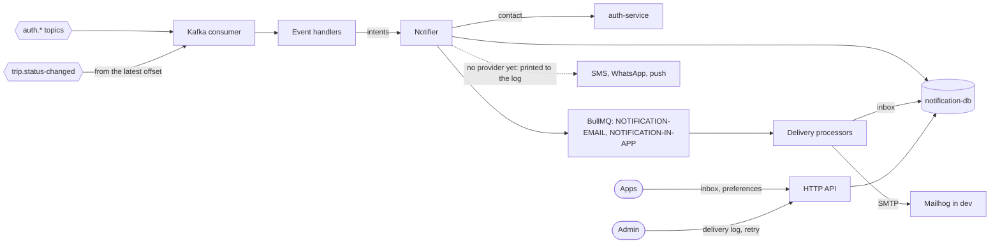
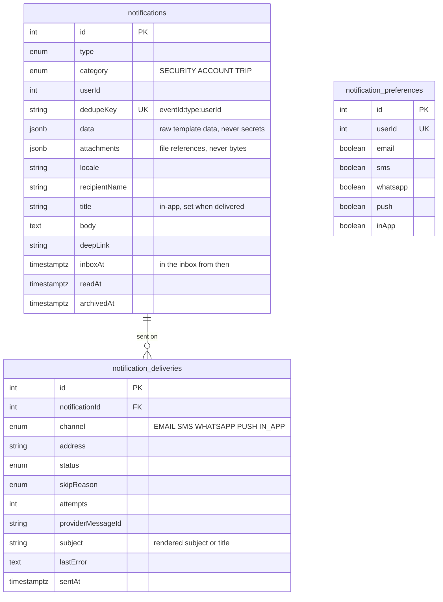
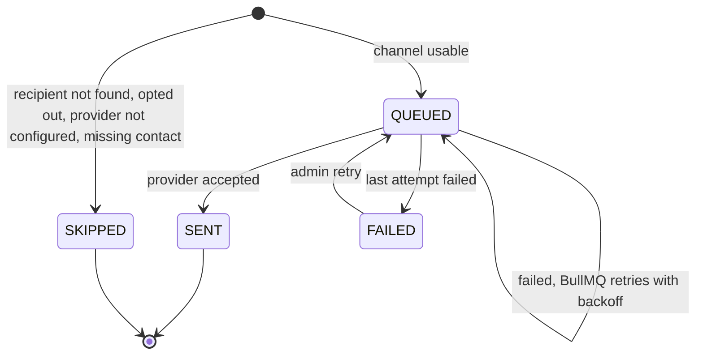
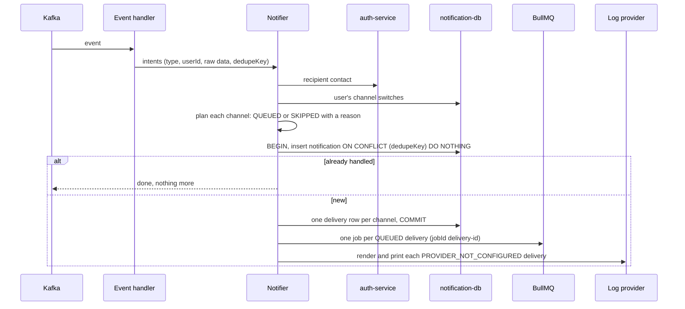
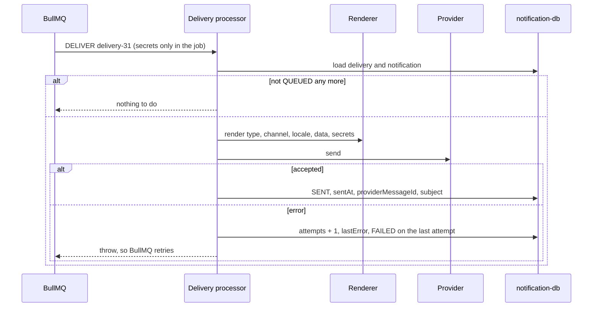

# notification-service

Turns events from other services into notifications on every channel, records every delivery
attempt, and serves the in-app inbox.

- **Port** 7001, database `notification-db` (41001), queues in Redis (44000), Swagger at
  `http://localhost:7001/api/docs`.
- **Owns:** the notification catalog, templates, channel delivery, the delivery log, the in-app
  inbox and each user's channel switches.
- **Does not own:** users. It reads a user's contact from auth-service when an event carries
  only an id.

## Context



## Four responsibilities

| Layer                                        | Knows                                                                      | Never knows         |
| -------------------------------------------- | -------------------------------------------------------------------------- | ------------------- |
| **Event handlers** (`modules/events/`)       | which event means which notification, for whom, with what raw data         | wording, channels   |
| **Catalog** (`NOTIFICATION_CATALOG`)         | per type: category, default channels, mandatory, needs secrets, deep link  | events, providers   |
| **Notifier** (`NotifierService`)             | dedupe, recipient, which channels apply and why not, persistence, queueing | wording, transports |
| **Delivery** (processor, renderer, provider) | how a type renders for a channel and locale, how to send                   | why it is sent      |

**Adding a notification** = a `NotificationTypeEnum` value, a catalog entry, a data interface in
`NotificationDataMap`, templates in `templates/<type>/`, and a mapping in an event handler. The
registry refuses to boot if a template for a default channel is missing.

## Data model



- **The inbox is the `notifications` table:** a row is in the app's inbox once its IN_APP
  delivery wrote `title`, `body`, `deepLink` and `inboxAt`. An email-only notification never
  shows there.
- **Every channel gets a delivery row**, even one that can't be used, with the reason, so
  nothing disappears silently. `UQ_notification_deliveries_channel` keeps one row per channel.
- **Preferences** are one row per user, one switch per channel; no row means everything is on.
- **In-app vs push:** push is a phone notification (FCM / APNs) that grabs attention even when
  the app is closed, and is gone once dismissed; in-app is the stored inbox the user reads in the
  app. Trip notifications default to both.



## Flow: an event becomes notifications



- **Skip reasons, first match wins:** `RECIPIENT_NOT_FOUND` (auth-service has no such user),
  `OPTED_OUT` (the user turned the channel off; mandatory types ignore this),
  `PROVIDER_NOT_CONFIGURED` (no real transport yet; printed to the terminal), `MISSING_CONTACT`
  (no email, phone or device token).
- **Channels:** an intent can name its own `channels` to send on one specific channel;
  otherwise the catalog's defaults apply.
- **Failures:** auth-service or the database down → the error is rethrown and Kafka redelivers.
  Redis down → the row stays QUEUED and the sweep adds its job later. A message that can never
  succeed (bad JSON, missing fields) is logged and skipped.
- **Idempotency:** the unique `dedupeKey` makes a redelivered event insert nothing. Verified by
  rewinding the consumer group.

### Why a queue after Kafka

Kafka hands a partition's messages to one consumer in order, one at a time. Sending inside the
consumer would let one slow SMTP server block every later message, and Kafka can't retry a
single message after a delay. So the consumer **decides and records** (fast, transactional), and
BullMQ **delivers**: per-delivery retries with backoff, per-channel queues and rate limits, and
an admin retry. The deliveries table doubles as the outbox for that hand-off.

## Flow: delivering



- **Retries:** 5 attempts, exponential backoff from 10 s. Verified by stopping Mailhog: the
  email retried and was sent once Mailhog came back.
- **Secrets** (the password-reset link) travel only in the job, which is removed on completion;
  they never reach the database or bull-board's completed list. A job lost before it ran can't
  be rebuilt, so the sweep marks such a delivery FAILED and the user asks again.
- **Sweep:** a `NOTIFICATION-DELIVERY-SWEEP` job scheduler re-queues QUEUED deliveries older
  than two minutes whose job never reached Redis.
- **Providers:** `EmailProvider` (nodemailer, with attachments streamed from their URLs),
  `InAppProvider` (writes the inbox fields), `LogProvider` for SMS, WhatsApp and push until a
  real provider replaces it in `ChannelProviderRegistry`.

## Templates

Handlebars files in `src/modules/notification/templates/`, compiled once at boot:

```text
layouts/email-html.hbs  layouts/email-text.hbs     the chrome every email shares
partials/               paragraph, note, panel, row, button, link-fallback, security-notice, cancelled-by
footers/<category>.<locale>.hbs
<type>/email-subject|email-preheader|email-html|email-text|title|body|short-text.<locale>.hbs
```

- **Raw data in, formatting in the template:** helpers `{{money fare currency}}`,
  `{{date occurredAt}}` and `{{eq a b}}` (`handlebars-helpers.ts`, typed).
- **Per channel:** email uses subject, preheader, html and text; push and in-app use title and
  body (plus the catalog's deep link); SMS and WhatsApp use short-text.
- **Escaping:** only HTML parts are escaped; text parts are compiled with `noEscape`. Type
  templates may not use triple braces; only the layout inserts the rendered content.
- **Locale:** files are `<part>.<locale>.hbs`. English exists today; the registry falls back to
  it, and the layout switches to `dir="rtl"` only when an Arabic template is really used.
  Arabic (مُسْرِع) is added as files, with no code change.
- **Prettier ignores `*.hbs`:** it reflows the plain-text templates as if they were HTML.
- `npx nx run notification-service:preview-templates` renders every type on each default channel
  to `dist/notification-previews/index.html`.

## HTTP API

| Route (`/api`)                                                 | Who      | Does                                                      |
| -------------------------------------------------------------- | -------- | --------------------------------------------------------- |
| `GET /notifications/me?unread=&category=&page=&limit=`         | any user | my inbox, newest first                                    |
| `GET /notifications/me/unread-count`                           | any user | `{ count }` for the badge                                 |
| `PATCH /notifications/me/:id/read`, `/unread`                  | owner    | read state (idempotent)                                   |
| `POST /notifications/me/read-all`                              | any user | `{ count }` changed                                       |
| `DELETE /notifications/me/:id`                                 | owner    | archive; the record is kept                               |
| `GET /notifications/me/preferences`                            | any user | one switch per channel                                    |
| `PUT /notifications/me/preferences`                            | any user | change some switches                                      |
| `GET /admin/notifications/deliveries?status=&channel=&userId=` | ADMIN    | the delivery log; `status=FAILED` is the dead-letter view |
| `POST /admin/notifications/deliveries/:id/retry`               | ADMIN    | re-queue a FAILED delivery                                |

Someone else's item answers `404`. Security notifications ignore the switches.

## Events consumed

| Topic                            | Notifications                                                    |
| -------------------------------- | ---------------------------------------------------------------- |
| `auth.user-register`             | WELCOME (email, in-app)                                          |
| `auth.user-logged-in`            | NEW_LOGIN (email, in-app; mandatory)                             |
| `auth.user-logged-out`           | none                                                             |
| `auth.user-change-password`      | PASSWORD_CHANGED (email; mandatory)                              |
| `auth.password-reset-requested`  | PASSWORD_RESET (email; the link is a secret)                     |
| `auth.password-reset-completed`  | PASSWORD_RESET_COMPLETED (email; mandatory)                      |
| `trip.status-changed` → ACCEPTED | TRIP_CONFIRMED to the customer, TRIP_ASSIGNED to the driver      |
| → COMPLETED                      | TRIP_RECEIPT to the customer                                     |
| → CANCELLED after acceptance     | TRIP_CANCELLED to the other party (both when an admin cancelled) |
| → EXPIRED                        | TRIP_EXPIRED to the customer                                     |

## Planned

- **Real SMS, WhatsApp and push providers** (Twilio or similar, WhatsApp Cloud API with
  pre-approved templates, FCM / APNs), plus phone numbers and device tokens from auth-service or
  a profile service.
- **Socket push** of new inbox items, with the parked live-location work.
- **User locale** stored in auth-service, and Arabic templates.
- **Internal send API** `POST /internal/notifications` (scope `NOTIFICATIONS_SEND`) for a service
  that needs to send directly, e.g. the planned reporting service emailing PDF reports as
  attachments; object storage for those files.
- **Kafka dead letters:** unprocessable messages are only logged today; a `notification.dlq`
  topic would keep them for replay.
- Per-user rate limits, quiet hours, digests, metrics.
