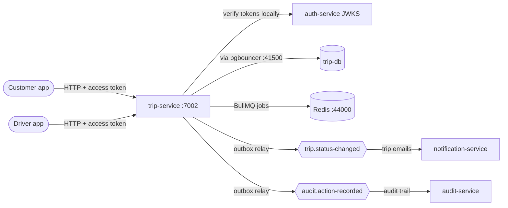
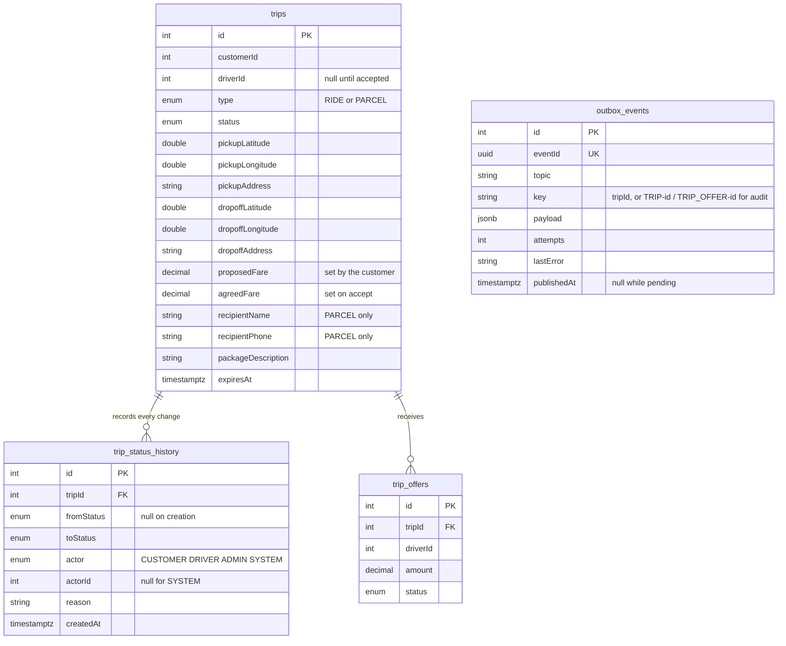
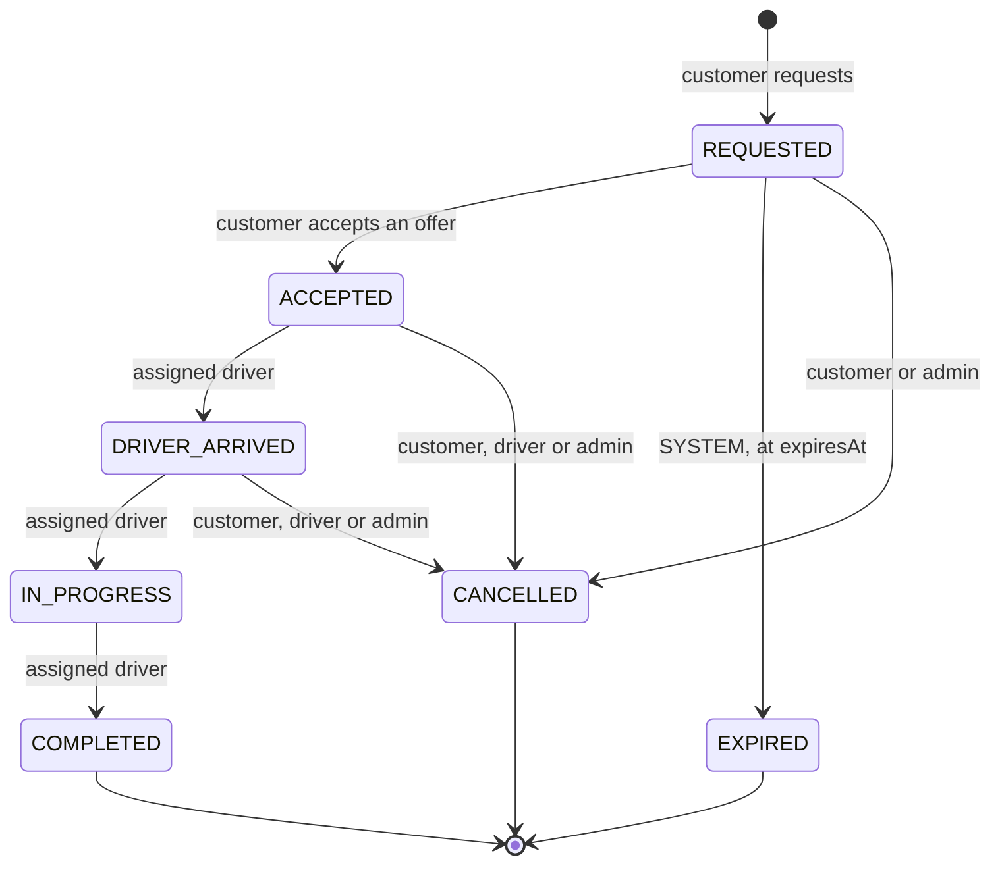
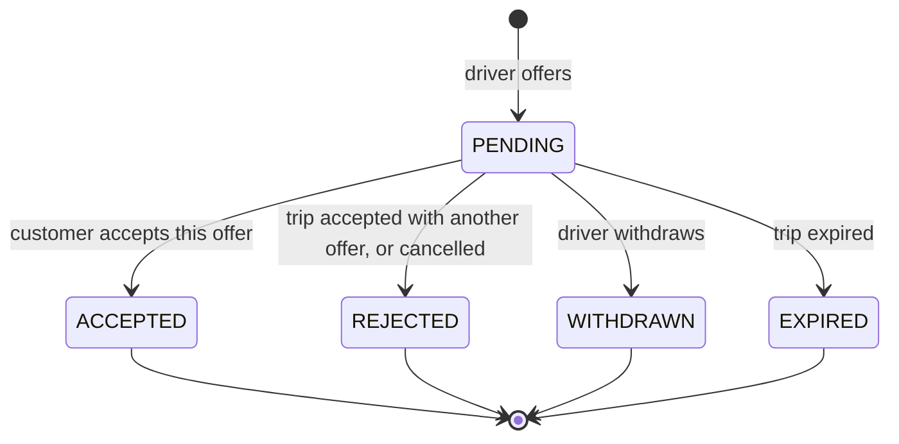
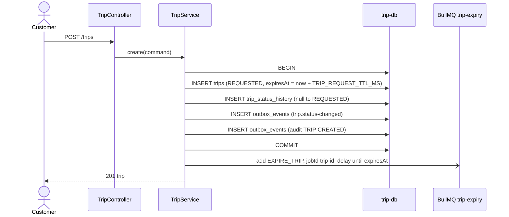
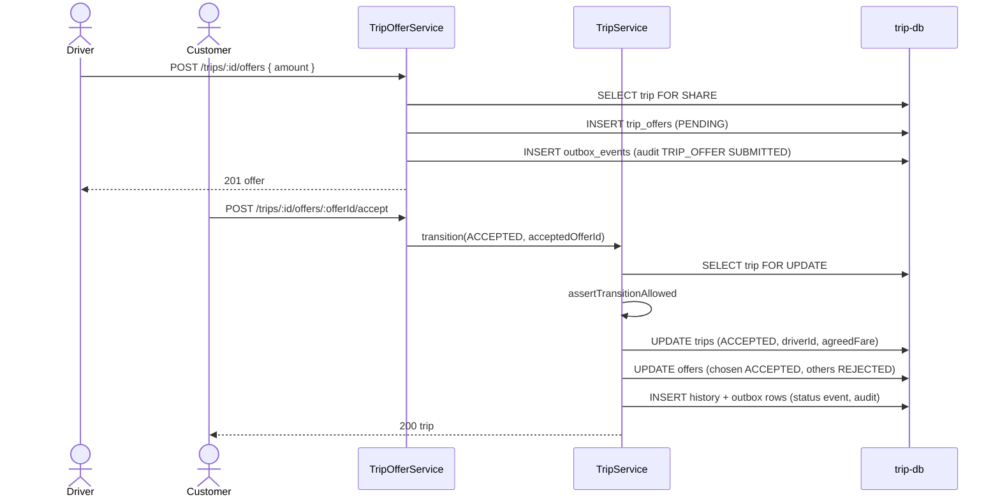
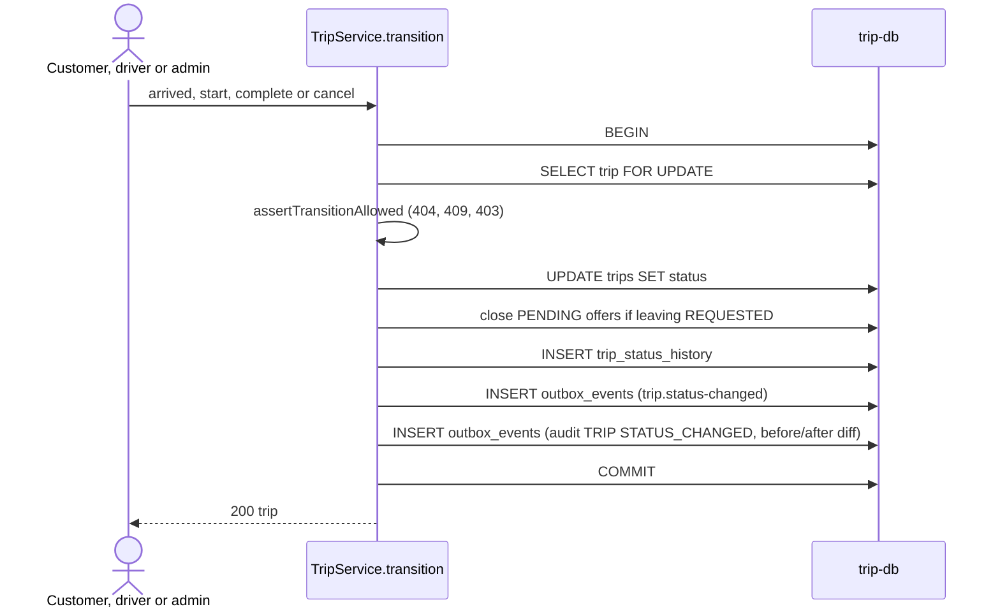
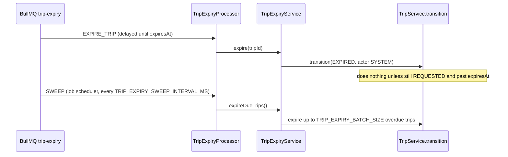
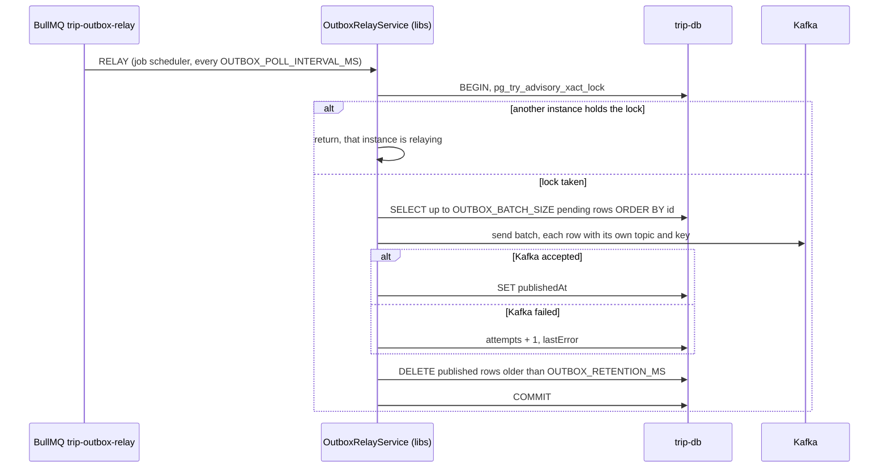

# trip-service

Owns trips, rides and parcels, from request to completion, in the inDrive style: the customer
proposes a fare, drivers accept it or counter-offer, and the customer picks one offer.

- **Port** 7002, database `trip-db` (41002), Swagger at `http://localhost:7002/api/docs`.
- **Owns:** trips, their status history, offers, and the outbox of trip and audit events.
- **Does not own:** users (auth-service) or messages to people (notification-service). It knows
  users only by id.

## Context

## Data model

- **One active trip each:** partial unique indexes `UQ_trips_active_customer` (REQUESTED,
  ACCEPTED, DRIVER_ARRIVED, IN_PROGRESS) and `UQ_trips_active_driver` (ACCEPTED, DRIVER_ARRIVED,
  IN_PROGRESS). A `23505` on either becomes a `409` naming who is double-booked.
- **One live offer per driver per trip:** `UQ_trip_offers_pending_driver`, unique
  `(tripId, driverId) WHERE status = 'PENDING'`.
- **A parcel names its recipient:** `CHK_trips_parcel_recipient`.
- **Money** is `decimal(10, 2)` in EGP (`TRIP_CURRENCY`), declared with `MONEY_COLUMN_OPTIONS`
  and validated with `@IsMoney()`, both from `@masr3/libs`. `decimalTransformer` reads pg's
  strings back as numbers; round to 2 decimals after any arithmetic.
- **History is the only record of when and who.** `trips` keeps no `acceptedAt` or
  `completedAt`: "completed at" is the `createdAt` of the COMPLETED history row.
  `TripActorEnum` belongs to this service; `SYSTEM` (expiry) is not a user role.

## Trip lifecycle

The table is `TRIP_TRANSITIONS` (`trip.constant.ts`). `assertTransitionAllowed`
(`trip.policy.ts`) applies it, and `TripService.transition` is the only way a status changes.
The policy answers, in this order:

1. `404` when it is not the actor's trip (ownership first, so strangers learn nothing).
2. `409` when that move does not exist from the current status.
3. `403` when the move exists but the actor's role may not make it.

## Offer lifecycle

**Invariant: no PENDING offer outlives its trip's REQUESTED status.**
`TripService.applyTransition` closes them all whenever a trip leaves REQUESTED.

## Flows

### Request a trip

- A second active trip for the same customer hits `UQ_trips_active_customer`: `409`.
- The expiry job is queued after the commit and not awaited. If Redis is down the request
  still succeeds, and the SWEEP job expires the trip instead.

### Make an offer, then accept one

- **Offers** lock the trip `FOR SHARE`: offers on one trip don't block each other, but wait for
  an acceptance in progress. `409` when the trip is not REQUESTED, has expired, or the driver
  already has an active trip. An `amount` equal to `proposedFare` means "I'll take it as is".
- **Lock order is always trip, then offers**, in both flows, so they cannot deadlock.
- Offers are their own module (`modules/trip-offer/`). Accepting one is a trip transition, so
  `TripOfferService` calls `TripService`, and `TripService` closes the other offers in the same
  transaction.
- **Withdrawing** locks the driver's own offer `FOR UPDATE`, checks it is still PENDING, marks
  it WITHDRAWN and writes a `TRIP_OFFER` `WITHDRAWN` audit row, in one transaction.
- **Accepting** finds the offer through the trip's `customerId`, so a stranger gets `404`
  whatever the offer's state. Two concurrent accepts: one wins, the other gets `409`. If the
  offer was withdrawn a moment earlier, the whole acceptance rolls back with `409`.
- **Privacy:** drivers browsing open trips (`GET /trips/open`, or `GET /trips/:id` while
  REQUESTED) never see a parcel recipient's name or phone.

### Run, cancel and every other status change

- A second concurrent caller waits on the row lock, then validates against the status the
  first one wrote, and gets a precise `409`. Verified with 20 concurrent cancel-vs-expire races.
- **Why not a guarded `UPDATE … WHERE status IN (…)`:** `RETURNING` gives only the new values,
  so `fromStatus` would be unknown, and `affected = 0` can't tell "not found", "not yours",
  "wrong status" and "lost the race" apart.
- The lock lives only inside the transaction, so it is safe under pgbouncer's `transaction`
  mode.

### Expiry

- The SWEEP catches trips whose delayed job was never queued (Redis down at creation).
- Both paths go through `transition`, so they can run on several instances at once without
  double-processing. A job that fires early does nothing.
- Accepting an offer on a trip past its deadline answers `409` "The trip request has expired".

### Publishing events (transactional outbox)

The outbox is the shared one from `@masr3/libs` (`OutboxModule.forRoot` in `AppModule`), on
queue `trip-outbox-relay` (`TRIP_OUTBOX_RELAY_QUEUE`) with lock id `7002001` (env
`OUTBOX_RELAY_LOCK_ID`).
The pattern (why, guarantees, costs) is in
[`docs/patterns/transactional-outbox.md`](../patterns/transactional-outbox.md). Pending or
failing events: `SELECT * FROM outbox_events WHERE "publishedAt" IS NULL ORDER BY id`.

## Events

| Topic                   | Key                            | Contract                                                 | Consumers                          |
| ----------------------- | ------------------------------ | -------------------------------------------------------- | ---------------------------------- |
| `trip.status-changed`   | `tripId`                       | `TripStatusChangedEvent` (`libs/src/lib/kafka/trip/`)    | notification-service (trip emails) |
| `audit.action-recorded` | `TRIP-<id>`, `TRIP_OFFER-<id>` | `AuditActionRecordedEvent` (`libs/src/lib/kafka/audit/`) | audit-service                      |

- **One topic for every status change.** Kafka orders messages only within a partition, so
  per-status topics could deliver "cancelled" before "accepted". Consumers filter on
  `toStatus`.
- The payload carries `tripId`, `type`, `customerId`, `driverId`, `fromStatus` (null on
  creation), `toStatus`, `actor`, `actorId`, `reason`, `proposedFare` and `agreedFare`, plus
  `eventId` and `occurredAt`.
- It also carries `pickupAddress`, `dropoffAddress` and `currency`, so a consumer can describe
  the trip ("Tahrir Square → Zamalek, EGP 95.00") without calling trip-service.
- Offers have no domain topic. Acceptance already emits REQUESTED → ACCEPTED.
- **Audit events** go through the same outbox, in the same transaction as the change
  (`AuditRecorderService` in `modules/audit/`): `TRIP` `CREATED` and `STATUS_CHANGED`,
  `TRIP_OFFER` `SUBMITTED` and
  `WITHDRAWN`. `changes` is `buildAuditChanges(before, after, TRIP_AUDITED_FIELDS)`.
  The allow-list leaves the parcel recipient's name and phone out. The actor keeps its role
  (`TRIP_ACTOR_TO_ROLE`, applied by `TripService.auditActorFor`); SYSTEM expiry is a SYSTEM
  actor. See
  [audit-service](audit-service.md).

## Authentication

Routes need a user access token, verified locally against auth-service's JWKS with the shared
guard from `@masr3/libs` (see [`docs/authentication.md`](../authentication.md)). Roles are
checked by `@Roles(...)`; ownership and assigned-driver checks stay in `TripService`. A
logged-out or re-roled user's access token keeps working here until it expires, at most 5
minutes.

## Planned

- **Live location, built and parked** on branch `wip/live-location` (not on `main`). It has
  Socket.IO on `/live` with handshake auth, driver positions in Redis GEO, new-trip alerts to
  nearby drivers, live trip following with distances, nearby open trips with PostGIS, trip
  locations buffered in Redis and written in batches, and correlation IDs. Resume from that
  branch; its commit message says how to restore the env and database.
- **Routing and ETA:** a routing engine (OSRM) for driving distance, ETA and fare suggestions.
  It builds on live location.
- **Ratings** after a completed trip, **driver profiles**, **payments**. Vehicles exist in
  [vehicle-service](vehicle-service.md); trips don't reference them yet.
- **Display names:** trip-service knows users only by id; names and car details come from
  events or auth-service.
