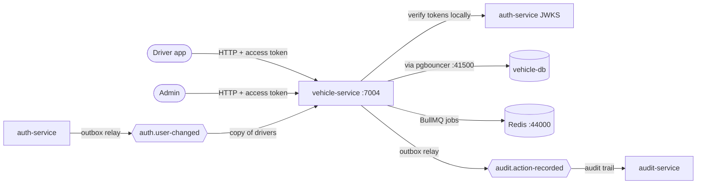
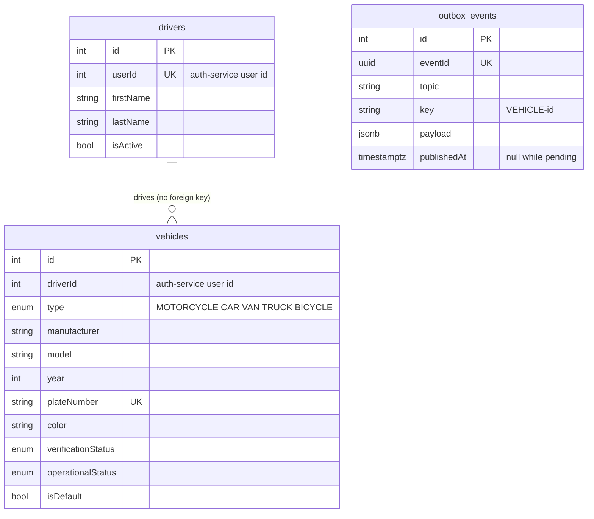
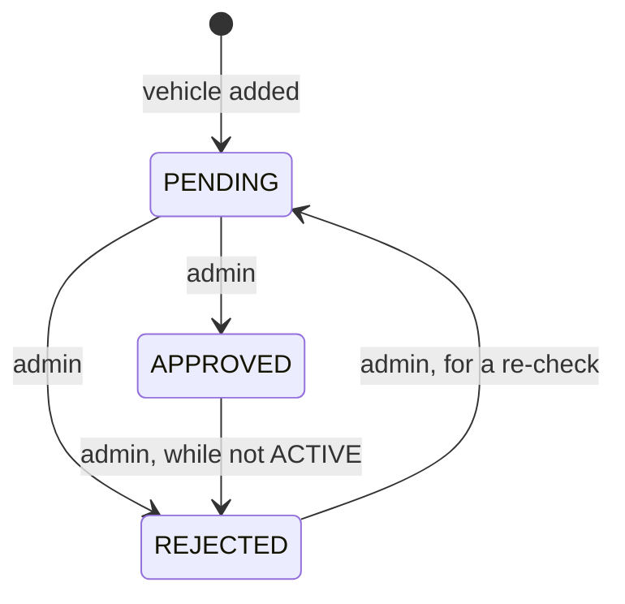
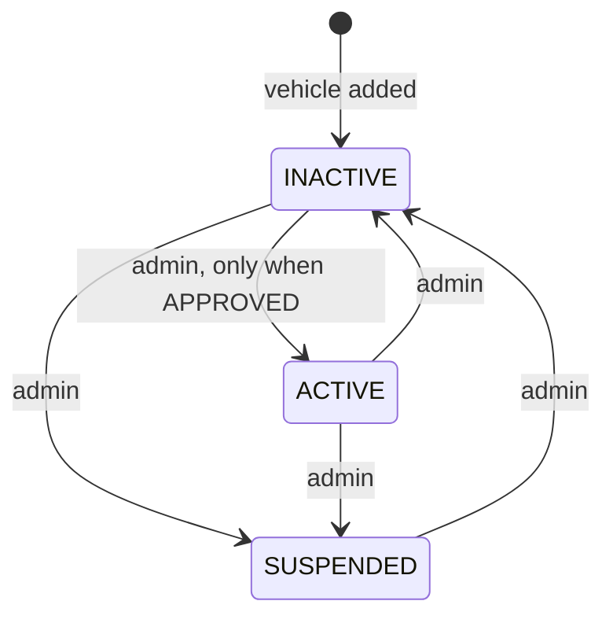
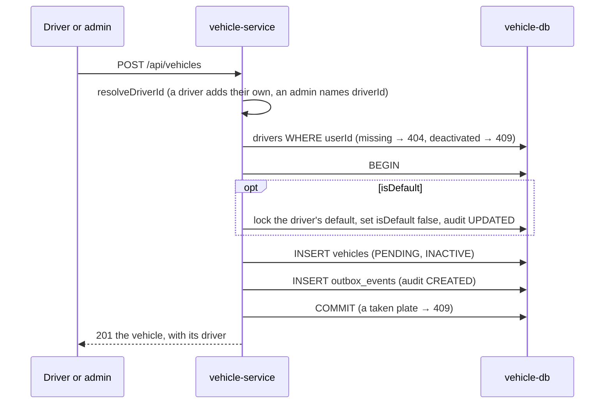
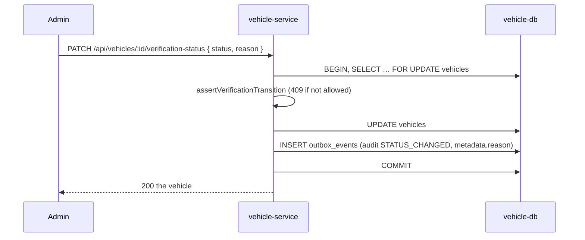
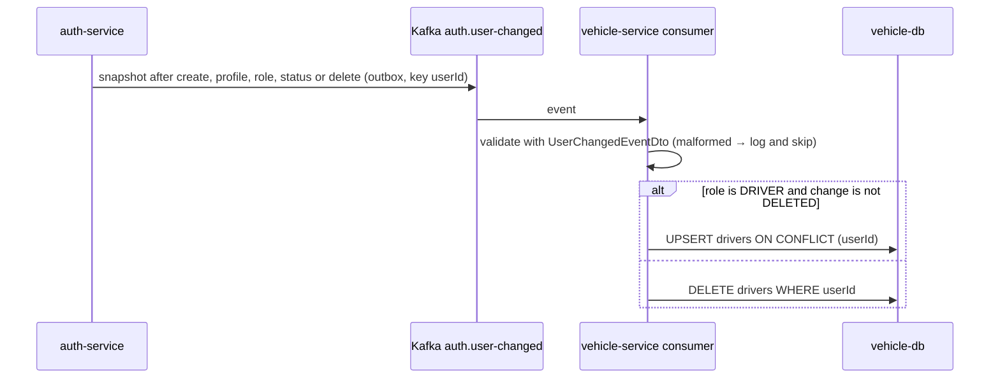

# vehicle-service

Owns drivers' vehicles: a driver registers the cars, motorcycles or vans they drive, and an admin
verifies each one and decides whether it may operate.

- **Port** 7004, database `vehicle-db` (41004), Swagger at `http://localhost:7004/api/docs`.
- **Owns:** vehicles, and the outbox of its audit events.
- **Keeps a copy of:** drivers (`drivers` table), fed by auth-service's `auth.user-changed`. auth-service
  owns users; this copy only gives vehicles a driver name and an active flag without an HTTP call.

## Context

## Data model

- **`vehicles.driverId` → `drivers.userId` has no foreign key.** `drivers` is a copy fed by
  Kafka. It can lag behind auth-service for a moment, and it loses a row when the user stops
  being a driver, while their vehicles stay.
- **Plate numbers are unique** (`UQ_vehicles_plate_number`). The DTO trims, collapses spaces and
  upper-cases them, so `abc  123` and `ABC 123` collide. A `23505` becomes a `409`.
- **One default vehicle per driver:** partial unique index `UQ_vehicles_driver_default` on
  `driverId WHERE "isDefault" = true`. Setting a new default first clears the old one, in the
  same transaction, and audits that change too.
- **No status history table.** Every status change is an audit event (`STATUS_CHANGED`, with the
  admin's `reason` in its metadata), so the history is in audit-service:
  `GET /api/admin/audits?entityType=VEHICLE&entityId=<id>`.

## Verification lifecycle

## Operational lifecycle

The tables are `VEHICLE_VERIFICATION_TRANSITIONS` and `VEHICLE_OPERATIONAL_TRANSITIONS`
(`vehicle.constant.ts`). `vehicle.policy.ts` applies them, plus the rules that join the two:
an ACTIVE vehicle must be APPROVED, so it must be deactivated before its verification changes.
Neither status is in the create or update DTO. Each has its own admin endpoint, and
`VehicleService.changeStatus` is the only code that writes them.

## Flows

### Add a vehicle

### Change a status

`operational-status` is the same flow with `assertOperationalTransition`. A second admin waits on
the row lock, then is validated against what the first one wrote.

### Keep the drivers copy current

- Each event is the user's whole state, and one user's events arrive in order (outbox, keyed by
  `userId`). Applying one is an overwrite, so a redelivery leaves the same row. That is why the
  consumer needs no `eventId` table.
- The consumer group starts at the beginning of the topic, so a fresh database rebuilds every
  driver. Users written before the topic existed (the seed) are published once with
  `npx nx run auth-service:users:publish-snapshots`.
- `role` and `change` are validated as strings, not enums: a role auth-service adds later is
  simply "not a driver" instead of a dropped message.

### Publishing events (transactional outbox)

The shared outbox from `@masr3/libs` (`OutboxModule.forRoot` in `AppModule`), on queue
`vehicle-outbox-relay` with lock id `7004001`, both from env (`OUTBOX_RELAY_QUEUE`,
`OUTBOX_RELAY_LOCK_ID`). See [`docs/patterns/transactional-outbox.md`](../patterns/transactional-outbox.md).

## API

| Route                                     | Roles             | Does                                      |
| ----------------------------------------- | ----------------- | ----------------------------------------- |
| `POST /vehicles`                          | DRIVER, ADMIN     | Add a vehicle (an admin sends `driverId`) |
| `GET /vehicles`                           | ADMIN             | List, filter and search every vehicle     |
| `GET /vehicles/me`                        | DRIVER            | The caller's vehicles                     |
| `GET /vehicles/:id`                       | its driver, ADMIN | One vehicle                               |
| `PATCH /vehicles/:id`                     | its driver, ADMIN | Edit details (no statuses, no owner)      |
| `DELETE /vehicles/:id`                    | its driver, ADMIN | Delete                                    |
| `PATCH /vehicles/:id/verification-status` | ADMIN             | Approve, reject or re-open                |
| `PATCH /vehicles/:id/operational-status`  | ADMIN             | Activate, deactivate or suspend           |

- Another driver's vehicle answers `404`, so a stranger learns nothing about it.
- Lists are paginated (`page`, `limit`) and newest first. `search` matches the plate, make, model
  and the driver's first or last name.

## Events

| Topic                   | Direction | Key            | Contract                                                 |
| ----------------------- | --------- | -------------- | -------------------------------------------------------- |
| `auth.user-changed`     | consumed  | `userId`       | `UserChangedEvent` (`libs/src/lib/kafka/auth/`)          |
| `audit.action-recorded` | produced  | `VEHICLE-<id>` | `AuditActionRecordedEvent` (`libs/src/lib/kafka/audit/`) |

Audited actions on `VEHICLE`: `CREATED`, `UPDATED`, `DELETED` and `STATUS_CHANGED`, with
`changes` from `buildAuditChanges(before, after, VEHICLE_AUDITED_FIELDS)`. vehicle-service owns no
topic, so it has no `kafka:create-topics` target.

## Authentication

Routes need a user access token, verified locally against auth-service's JWKS with the shared
guard from `@masr3/libs` (see [`docs/authentication.md`](../authentication.md)). Roles are checked
by `@Roles(...)`; ownership is checked in `vehicle.policy.ts`.

## Planned

- **Use vehicles in trips:** a driver's offer or an accepted trip names the vehicle, and only an
  ACTIVE one may take a trip.
- **Documents:** registration and insurance uploads for verification, with expiry dates that
  suspend a vehicle automatically.
- **Vehicle events:** a `vehicle.*` topic once another service needs to react to status changes.
